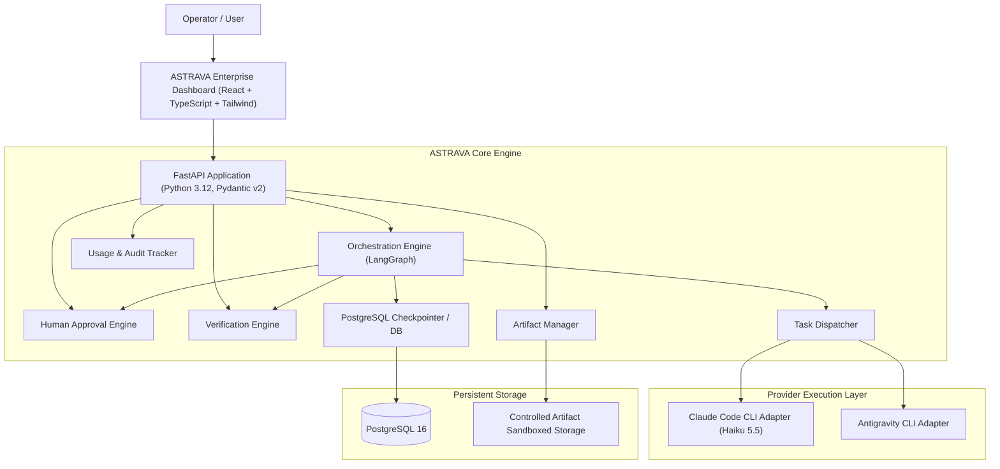
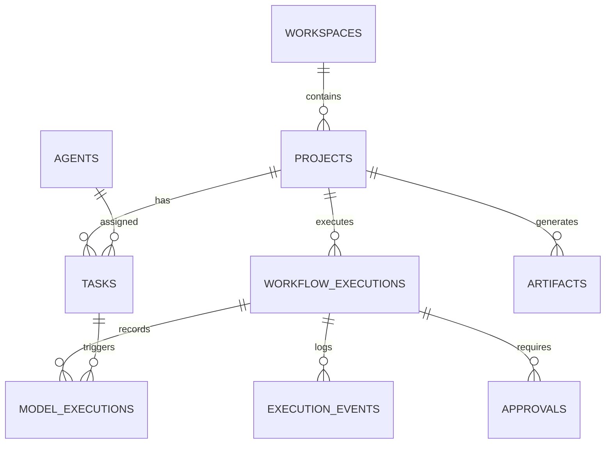

# ASTRAVA System Architecture
**Version:** 1.0.0
**Brand Personality:** Enterprise ("From vision to execution.")

---

## 1. System Overview

ASTRAVA is an enterprise AI creation and orchestration platform designed to turn high-level vision and objectives into functioning software and media assets.

The platform is architected as a **Modular Monolith**:
- Clean separation of concerns between backend domain services, orchestration engine, CLI provider adapters, and frontend client.
- Avoids premature distributed complexity while maintaining high testability, auditability, and execution safety.

---

## 2. Component Architecture

### 2.1 Backend Core (FastAPI & Pydantic v2)
- **Framework:** FastAPI with asynchronous request handlers.
- **Data Validation:** Pydantic v2 schemas for all inputs, outputs, and internal event messages.
- **ORM & Data Layer:** SQLAlchemy 2.0 (asyncio) with Alembic for relational migrations.
- **Security:** Strict sandboxed path resolution, argument array subprocess execution (never raw shell), environment variable filtering, and secret redaction.

### 2.2 Orchestration Engine (LangGraph)
- **Workflows:** Stateful multi-step graphs coordinating:
  1. Plan formulation (validated structured output).
  2. Plan inspection & approval check (interrupt on required approval).
  3. Task dispatching to executor.
  4. Execution output capture and sandboxed working directory monitoring.
  5. Deterministic verification (ruff, pytest, typecheck, build).
  6. Git diff and artifact capture.
  7. State persistence.
- **Checkpointing:** Backed by PostgreSQL to survive backend restarts and support pause/resume.

### 2.3 Provider Execution Layer
- **Claude Code CLI Adapter:**
  - Invokes `claude --model haiku -p --output-format json "<task_prompt>"` within a dedicated project working directory.
  - Subprocess executed with argument arrays (`shell=False`).
  - Strict timeouts, stdout/stderr capture, exit code tracking.
  - Metadata parsing: tokens, cache reads/writes, durations, cost calculations.
- **Future Adapters:** Pluggable `BaseProvider` architecture ready for Antigravity CLI and additional models.

### 2.4 Human Approval Engine
- Workflows pause automatically before high-risk tasks (destructive filesystem changes, deployments, paid operations).
- Emits approval requests with risk level, context, and expected impact.
- Resumes workflow seamlessly once approved or branches to alternative on rejection.

### 2.5 Verification Engine
- AI output is treated as untrusted.
- Executes deterministic validation tools:
  - Python: `ruff check`, `ruff format --check`, `pytest`.
  - Frontend: `npm run lint`, `tsc --noEmit`, `npm run build`.
  - System: Git diff inspection, health checks.

### 2.6 Artifact Management
- Metadata stored in PostgreSQL (`artifacts` table).
- Content stored in sandboxed local filesystem directory (`storage/artifacts/<project_id>/...`).
- Path traversal protection ensuring all paths remain strictly inside the project's designated artifact storage.

---

## 3. Database Schema Concept

---

## 4. Multi-Agent Intelligence & Dynamic DAG Orchestration (V1.2)

### 4.1 Reusable Agent Registry
Agents in ASTRAVA are modeled as configurable autonomous capabilities, not hardcoded prompt strings. Each agent in the `agents` table specifies:
- **Identity & Slug:** Unique identifier (e.g. `product-researcher`, `solution-architect`, `scriptwriter`).
- **Studio Alignment:** SaaS Studio (7 specialized agents) or Media Studio (9 specialized agents).
- **Capability Taxonomy:** Standardized tags for discovery and matching (`market_research`, `system_design`, `screenwriting`, etc.).
- **System Directives:** Precise role responsibilities and behavioral boundaries.
- **Input & Output Contracts:** JSON Schema / Pydantic definitions enforcing structured outputs.
- **Execution & Tool Config:** Assigned model (`claude-haiku-5-5`), timeouts, and available tool capabilities.
- **Status & Versioning:** Independent toggleable `is_enabled` status and semantic version strings.

### 4.2 Semantic Objective Understanding
Before workflow construction, objectives pass through `IntelligenceService.understand_objective`:
1. Claude Haiku 5.5 performs zero-shot semantic analysis, extracting intended outcomes, studio classification, required capabilities, and deliverables.
2. Evaluates ambiguity: if critical parameters are absent, generates targeted clarification prompts rather than assuming scope.
3. Fallback deterministic heuristic rules ensure reliability during offline or test environments.

### 4.3 Dynamic DAG Planning & Parallel Execution Stages
The workflow planner (`PlannerService`) transforms the interpreted objective into a Directed Acyclic Graph (DAG):
1. **Cycle Prevention:** Computes in-degree dependency graphs via Kahn's algorithm; rejects circular dependencies deterministically.
2. **Concurrent Waves:** Partitions tasks into parallel execution stages. Independent tasks (e.g. Market Research and Competitor Analysis in SaaS; Content Research and Audience Analysis in Media) execute concurrently via `asyncio.gather`.
3. **Upstream Context Injection:** Tasks receive synthesized artifacts and text outputs from their upstream prerequisite dependencies.
4. **Deterministic QA Verification:** Tasks assigned to `qa-engineer` or deterministic executors run programmatic test suites and code checks.

---

## 5. Frontend Visual Architecture
- **Enterprise Design System:**
  - Primary colors: Midnight Navy (`#101827`), Slate Blue (`#253B59`), Electric Blue (`#3B82F6`), Ice Blue (`#B9D8FF`).
  - Neutrals: Cloud White (`#F8FAFC`), Steel Gray (`#64748B`).
  - Semantics: Success (`#16A34A`), Warning (`#D97706`), Danger (`#DC2626`), Info (`#2563EB`).
  - Typography: Inter for UI body/headings, JetBrains Mono for code/logs.
- **Navigation:**
  - Overview
  - Command Center (with live Semantic Understanding & DAG visualization)
  - Agent Registry (with specs inspector and enable/disable toggle)
  - Projects
  - Executions
  - Artifacts
  - Approvals
  - Intelligence
  - Settings

---

## 6. Persistent Project Intelligence & Knowledge Retrieval (V1.3)

### 6.1 Persistent Project Memory
ASTRAVA maintains persistent knowledge across separate execution workflows:
- **10 Core Categories:** `objective`, `requirement`, `constraint`, `decision`, `discovery`, `preference`, `open_question`, `risk`, `milestone`, `rejected_approach`.
- **4-Tier Provenance Hierarchy:**
  - `user_provided` (Confidence: 1.00, Verified: True)
  - `verified_finding` (Confidence: 0.95, Verified: True)
  - `agent_conclusion` (Confidence: 0.70, Verified: False)
  - `assumption` (Confidence: 0.50, Verified: False)
- **Immutable Revision Chains:** Updates create revision `N+1` pointing to `previous_revision_id` and mark the previous revision `SUPERSEDED`. Verification is automatically reset on text modifications.
- **Append-Only Audit Trail:** `MemoryAuditLog` records every creation, modification, verification, or conflict resolution with strict code-level immutability (`PermissionError` on update/delete).

### 6.2 Artifact Lineage & Versioning
- Artifacts track `version`, `parent_artifact_id`, `superseded_by_id`, and `verification_status`.
- Cycle prevention protects against direct self-parenting (`parent_id <> id`) and multi-hop ancestry cycles (`A -> B -> C -> A`).
- Supersession enforces strict forward version progression (`target.version > artifact.version`).
- Rejects cross-project lineage links (`CROSS_PROJECT_LINEAGE_ERROR`).

### 6.3 Modular Knowledge Retrieval Engine
The retrieval engine operates under `backend/app/services/retrieval/`:
- **`QueryProcessor`:** Sanitizes query text, enforces length bounds (max 500 chars), and extracts tokens for full-text search.
- **`MetadataFilter`:** Constructs parameter-safe SQLAlchemy expressions enforcing mandatory `project_id` scoping and enum validation.
- **`MemoryRetriever`:** Queries PostgreSQL 16 using GIN-indexed full-text search (`tsvector`/`tsquery`) with `ts_rank_cd` scoring and metadata filtering.
- **`ArtifactRetriever`:** Searches project artifacts and enriches results with ancestry and supersession lineage via `ArtifactIntelligenceService`.
- **`RetrievalRanker`:** Deterministic multi-signal ranking:
  $$S = S_{\text{text}} \times (0.40 \cdot W_{\text{prov}} + 0.30 \cdot W_{\text{verif}} + 0.20 \cdot W_{\text{recency}} + 0.10 \cdot W_{\text{status}})$$
  where text relevance serves as a dominant gating factor so that high provenance cannot rank irrelevant content above relevant findings.
- **`ContextAssembler`:** Assembles structured Markdown prompt context strictly capped at a configurable character budget (default 4,000 characters). Preserves complete item boundaries, attribution chips, and reports omitted items.
- **`RetrievalService`:** Public orchestration facade returning explainable `RetrievalResult` objects with execution timing and filter traces.

### 6.4 LangGraph Workflow Memory Integration
The workflow engine integrates persistent memory into the execution lifecycle via two specialized nodes:
- **`retrieve_knowledge_node` (Pre-Planning Entrypoint):**
  - Serves as the starting node of the LangGraph execution graph (`retrieve_knowledge` -> `plan`).
  - Calls `RetrievalService.retrieve_context` using the objective and project ID.
  - Stores `retrieved_memories`, `retrieved_artifacts`, and assembled `retrieval_context` into `OrchestrationState`.
  - Tolerates transient retrieval errors gracefully without failing the workflow, falling back to clean default empty state.
- **Context Injection into Agent Prompts:**
  - `PlannerService.generate_plan` accepts bounded `retrieval_context` and presents active constraints, decisions, and past milestones to Claude Haiku during plan formulation.
  - `_execute_single_task` injects bounded project knowledge context directly into downstream agent prompts, allowing specialized agents to respect known architectural constraints and decisions without re-querying users.
- **`ingest_knowledge_node` (Post-Execution Durable Ingestion):**
  - Executed after all task waves and verification steps complete (`route_after_artifact` -> `ingest_knowledge` -> `complete_node` -> `END`).
  - Extracts candidates using `KnowledgeExtractor`:
    - Overall workflow milestone completion (`MemoryCategory.MILESTONE`).
    - Architectural decisions from solution architect / tech lead tasks (`MemoryCategory.DECISION`).
    - Constraints identified during task execution (`MemoryCategory.CONSTRAINT`).
    - New technical discoveries from research or exploration tasks (`MemoryCategory.DISCOVERY`).
  - **Strict Provenance Rules:**
    - Tasks backed by passing verification checks receive `AGENT_VERIFIED` provenance, `confidence_score = 0.95`, and `is_verified = True`.
    - Unverified agent assertions receive `AGENT_CONCLUSION` provenance, `confidence_score = 0.70`, and `is_verified = False`.
  - **Idempotency & Crash Recovery:**
    - Before writing, checks if `source_execution_id` already persisted memories to PostgreSQL. If found, returns existing memory IDs without duplicating records.
    - Idempotently ignores reruns if state indicates `ingestion_status == "completed"`.
    - Creates immutable audit entries in `memory_audit_logs` for all created memories.

### 6.5 REST APIs & Schemas for Project Intelligence
The project intelligence capabilities are exposed via REST under `/api/v1/`:
- **Architecture & Conventions:**
  - Routers act as thin coordinators; all state transitions, validation, and audit writes are delegated directly to `MemoryService`, `MemoryAuditService`, and `ArtifactIntelligenceService`.
  - Mandatory project isolation: every endpoint verifies project existence and validates that resources belong to `project_id`, returning 404 for missing or cross-project resources.
  - Strict separation of request schemas (`MemoryCreateRequest`, `MemoryUpdateRequest`, `MemoryVerifyRequest`, `MemoryConflictResolveRequest`) and response schemas (`MemoryRead`, `MemoryConflictItem`, `MemoryAuditLogRead`, `ArtifactLineageResponse`).
- **Endpoint Inventory:**
  - `GET /api/v1/projects/{project_id}/memories`: List and filter memories with deterministic pagination, category/provenance/status filters, date bounds, search query, and default exclusion of historical records.
  - `POST /api/v1/projects/{project_id}/memories`: Create memory with default user provenance (status 201). Prevents direct verification spoofing.
  - `GET /api/v1/projects/{project_id}/memories/conflicts`: List detected conflicts with partner memory details.
  - `GET /api/v1/projects/{project_id}/memories/{memory_id}`: Detail view of a project memory.
  - `PATCH /api/v1/projects/{project_id}/memories/{memory_id}`: Creates immutable revision, resets verification on content change, and requires `expected_revision` for optimistic concurrency (returns 409 Conflict on mismatch).
  - `POST /api/v1/projects/{project_id}/memories/{memory_id}/archive`: Soft-archive active memory.
  - `POST /api/v1/projects/{project_id}/memories/{memory_id}/restore`: Restore archived memory back to ACTIVE.
  - `POST /api/v1/projects/{project_id}/memories/{memory_id}/verify`: Explicit verification workflow; promotes `AGENT_CONCLUSION` to `VERIFIED_FINDING` with verifier identity and evidence details.
  - `POST /api/v1/projects/{project_id}/memories/{memory_id}/resolve`: Resolves conflicts using `supersede`, `reject`, or `merge` strategies transactionally.
  - `GET /api/v1/projects/{project_id}/memories/{memory_id}/audit`: Read-only, paginated audit trail. Mutation endpoints are prohibited.
  - `GET /api/v1/projects/{project_id}/artifacts/{artifact_id}/lineage`: Returns full ancestry, children, and supersession graph. Also accessible via `/api/v1/artifacts/{artifact_id}/lineage`.

### 6.6 Frontend Project Intelligence Experience (Memory Bank UI)
The project intelligence user interface is integrated directly into the `/intelligence` route of the React 19 application:
- **Project Scoping & Selector:** Header-level project selector guarantees strict project boundary isolation across all intelligence operations.
- **Memory Bank Dashboard (`IntelligencePage.tsx`):**
  - KPI summary metrics (`total_active`, `verified_findings`, `agent_conclusions`, `open_conflicts`, `archived`) powered by single-query SQL aggregation endpoint `GET /projects/{project_id}/memories/stats`.
  - Live search bar and multi-dimensional filtering (Category, Provenance, Verification Status, Include Archived).
  - Server-paginated memory list with category tags, revision counters, provenance badges, verification badges, and relative timestamps.
- **Visual Intelligence Components:**
  - **`ProvenanceBadge.tsx`:** Renders visual origin tags across the 4-tier provenance hierarchy (`user_provided`, `verified_finding`, `agent_conclusion`, `assumption`) with calibrated score indicators.
  - **`VerificationBadge.tsx`:** Semantically decoupled from provenance, indicating explicit human operator or QA verification with verifier identity tooltip and verification date.
  - **`MemoryDetailModal.tsx`:** Comprehensive inspector with three views:
    - *Overview:* Complete factual content, technical metadata grid (status, revision, conflict status, source execution, source task, source agent), and one-click actions for explicit verification and soft-archive/restore.
    - *Revision History:* Immutable revision log fetched from `GET /projects/{project_id}/memories/{memory_id}/revisions` displaying past summary and content evolutions.
    - *Audit Trail:* Immutable chronological event timeline from `GET /projects/{project_id}/memories/{memory_id}/audit` tracking actors, actions, and rationales.
  - **`MemoryFormModal.tsx`:** Modal for manual memory creation and editing. Employs optimistic concurrency control: edits submit `expected_revision`; on HTTP 409 conflict, prompts the user without silently overwriting concurrent changes. Content updates to verified memories trigger warnings indicating that the new revision will reset verification.
  - **`ConflictWorkbench.tsx`:** Side-by-side contradiction resolution interface:
    - Scans and lists colliding memory pairs via `GET /projects/{project_id}/memories/conflicts`.
    - Side-by-side comparison of active memory vs. conflicting counterpart (summary, provenance, revision, status).
    - Three transactional resolution strategies:
      - *Supersede:* Retains selected memory, sets partner to SUPERSEDED.
      - *Reject:* Rejects selected memory as false/outdated, keeps partner active.
      - *Merge:* Synthesizes both memories into a single reconciled finding with custom summary and content.
  - **`ArtifactLineageExplorer.tsx`:** Hierarchical derivation tree visualizer:
    - Traces complete ancestry paths, direct derivation parents, current focus artifact, derived descendants, and supersession chains via `GET /projects/{project_id}/artifacts/{artifact_id}/lineage`.
    - Interactive tree nodes allow navigating up and down derivation branches.
  - **`Model Telemetry & Usage`:** Preserved view maintaining token consumption, compute duration, cost estimations, and granular model execution audit tables.

