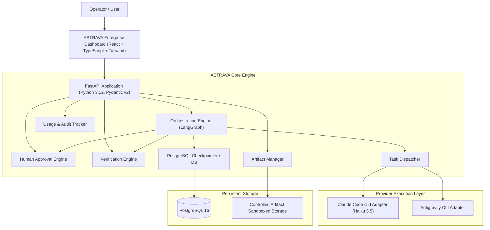
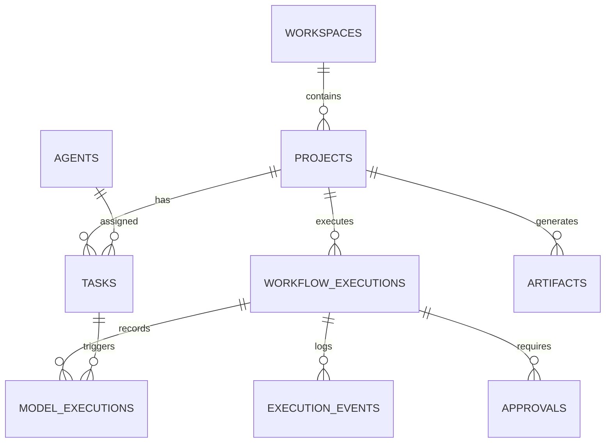

# ASTRAVA System Architecture
**Version:** 1.0.0
**Brand Personality:** Enterprise ("From vision to execution.")

---

## 1. System Overview

ASTRAVA is an enterprise AI creation and orchestration platform designed to turn high-level vision and objectives into functioning software and media assets.

The platform is architected as a **Modular Monolith**:
- Clean separation of concerns between backend domain services, orchestration engine, CLI provider adapters, and frontend client.
- Avoids premature distributed complexity while maintaining high testability, auditability, and execution safety.



---

## 2. Component Architecture

### 2.1 Backend Core (FastAPI & Pydantic v2)
- **Framework:** FastAPI with asynchronous request handlers.
- **Data Validation:** Pydantic v2 schemas for all inputs, outputs, and internal event messages.
- **ORM & Data Layer:** SQLAlchemy 2.0 (asyncio) with Alembic for relational migrations.
- **Security:** Strict sandboxed path resolution, argument array subprocess execution (never raw shell), environment variable filtering, and secret redaction.

### 2.2 Orchestration Engine (LangGraph)
- **Workflows:** Stateful multi-step graphs coordinating:
  1. Plan formulation (validated structured output).
  2. Plan inspection & approval check (interrupt on required approval).
  3. Task dispatching to executor.
  4. Execution output capture and sandboxed working directory monitoring.
  5. Deterministic verification (ruff, pytest, typecheck, build).
  6. Git diff and artifact capture.
  7. State persistence.
- **Checkpointing:** Backed by PostgreSQL to survive backend restarts and support pause/resume.

### 2.3 Provider Execution Layer
- **Claude Code CLI Adapter:**
  - Invokes `claude --model haiku -p --output-format json "<task_prompt>"` within a dedicated project working directory.
  - Subprocess executed with argument arrays (`shell=False`).
  - Strict timeouts, stdout/stderr capture, exit code tracking.
  - Metadata parsing: tokens, cache reads/writes, durations, cost calculations.
- **Future Adapters:** Pluggable `BaseProvider` architecture ready for Antigravity CLI and additional models.

### 2.4 Human Approval Engine
- Workflows pause automatically before high-risk tasks (destructive filesystem changes, deployments, paid operations).
- Emits approval requests with risk level, context, and expected impact.
- Resumes workflow seamlessly once approved or branches to alternative on rejection.

### 2.5 Verification Engine
- AI output is treated as untrusted.
- Executes deterministic validation tools:
  - Python: `ruff check`, `ruff format --check`, `pytest`.
  - Frontend: `npm run lint`, `tsc --noEmit`, `npm run build`.
  - System: Git diff inspection, health checks.

### 2.6 Artifact Management
- Metadata stored in PostgreSQL (`artifacts` table).
- Content stored in sandboxed local filesystem directory (`storage/artifacts/<project_id>/...`).
- Path traversal protection ensuring all paths remain strictly inside the project's designated artifact storage.

---

## 3. Database Schema Concept



---

## 4. Multi-Agent Intelligence & Dynamic DAG Orchestration (V1.2)

### 4.1 Reusable Agent Registry
Agents in ASTRAVA are modeled as configurable autonomous capabilities, not hardcoded prompt strings. Each agent in the `agents` table specifies:
- **Identity & Slug:** Unique identifier (e.g. `product-researcher`, `solution-architect`, `scriptwriter`).
- **Studio Alignment:** SaaS Studio (7 specialized agents) or Media Studio (9 specialized agents).
- **Capability Taxonomy:** Standardized tags for discovery and matching (`market_research`, `system_design`, `screenwriting`, etc.).
- **System Directives:** Precise role responsibilities and behavioral boundaries.
- **Input & Output Contracts:** JSON Schema / Pydantic definitions enforcing structured outputs.
- **Execution & Tool Config:** Assigned model (`claude-haiku-5-5`), timeouts, and available tool capabilities.
- **Status & Versioning:** Independent toggleable `is_enabled` status and semantic version strings.

### 4.2 Semantic Objective Understanding
Before workflow construction, objectives pass through `IntelligenceService.understand_objective`:
1. Claude Haiku 5.5 performs zero-shot semantic analysis, extracting intended outcomes, studio classification, required capabilities, and deliverables.
2. Evaluates ambiguity: if critical parameters are absent, generates targeted clarification prompts rather than assuming scope.
3. Fallback deterministic heuristic rules ensure reliability during offline or test environments.

### 4.3 Dynamic DAG Planning & Parallel Execution Stages
The workflow planner (`PlannerService`) transforms the interpreted objective into a Directed Acyclic Graph (DAG):
1. **Cycle Prevention:** Computes in-degree dependency graphs via Kahn's algorithm; rejects circular dependencies deterministically.
2. **Concurrent Waves:** Partitions tasks into parallel execution stages. Independent tasks (e.g. Market Research and Competitor Analysis in SaaS; Content Research and Audience Analysis in Media) execute concurrently via `asyncio.gather`.
3. **Upstream Context Injection:** Tasks receive synthesized artifacts and text outputs from their upstream prerequisite dependencies.
4. **Deterministic QA Verification:** Tasks assigned to `qa-engineer` or deterministic executors run programmatic test suites and code checks.

---

## 5. Frontend Visual Architecture
- **Enterprise Design System:**
  - Primary colors: Midnight Navy (`#101827`), Slate Blue (`#253B59`), Electric Blue (`#3B82F6`), Ice Blue (`#B9D8FF`).
  - Neutrals: Cloud White (`#F8FAFC`), Steel Gray (`#64748B`).
  - Semantics: Success (`#16A34A`), Warning (`#D97706`), Danger (`#DC2626`), Info (`#2563EB`).
  - Typography: Inter for UI body/headings, JetBrains Mono for code/logs.
- **Navigation:**
  - Overview
  - Command Center (with live Semantic Understanding & DAG visualization)
  - Agent Registry (with specs inspector and enable/disable toggle)
  - Projects
  - Executions
  - Artifacts
  - Approvals
  - Intelligence
  - Settings

---

## 6. Persistent Project Intelligence & Knowledge Retrieval (V1.3)

### 6.1 Persistent Project Memory
ASTRAVA maintains persistent knowledge across separate execution workflows:
- **10 Core Categories:** `objective`, `requirement`, `constraint`, `decision`, `discovery`, `preference`, `open_question`, `risk`, `milestone`, `rejected_approach`.
- **4-Tier Provenance Hierarchy:**
  - `user_provided` (Confidence: 1.00, Verified: True)
  - `verified_finding` (Confidence: 0.95, Verified: True)
  - `agent_conclusion` (Confidence: 0.70, Verified: False)
  - `assumption` (Confidence: 0.50, Verified: False)
- **Immutable Revision Chains:** Updates create revision `N+1` pointing to `previous_revision_id` and mark the previous revision `SUPERSEDED`. Verification is automatically reset on text modifications.
- **Append-Only Audit Trail:** `MemoryAuditLog` records every creation, modification, verification, or conflict resolution with strict code-level immutability (`PermissionError` on update/delete).

### 6.2 Artifact Lineage & Versioning
- Artifacts track `version`, `parent_artifact_id`, `superseded_by_id`, and `verification_status`.
- Cycle prevention protects against direct self-parenting (`parent_id <> id`) and multi-hop ancestry cycles (`A -> B -> C -> A`).
- Supersession enforces strict forward version progression (`target.version > artifact.version`).
- Rejects cross-project lineage links (`CROSS_PROJECT_LINEAGE_ERROR`).

### 6.3 Modular Knowledge Retrieval Engine
The retrieval engine operates under `backend/app/services/retrieval/`:
- **`QueryProcessor`:** Sanitizes query text, enforces length bounds (max 500 chars), and extracts tokens for full-text search.
- **`MetadataFilter`:** Constructs parameter-safe SQLAlchemy expressions enforcing mandatory `project_id` scoping and enum validation.
- **`MemoryRetriever`:** Queries PostgreSQL 16 using GIN-indexed full-text search (`tsvector`/`tsquery`) with `ts_rank_cd` scoring and metadata filtering.
- **`ArtifactRetriever`:** Searches project artifacts and enriches results with ancestry and supersession lineage via `ArtifactIntelligenceService`.
- **`RetrievalRanker`:** Deterministic multi-signal ranking:
  $$S = S_{\text{text}} \times (0.40 \cdot W_{\text{prov}} + 0.30 \cdot W_{\text{verif}} + 0.20 \cdot W_{\text{recency}} + 0.10 \cdot W_{\text{status}})$$
  where text relevance serves as a dominant gating factor so that high provenance cannot rank irrelevant content above relevant findings.
- **`ContextAssembler`:** Assembles structured Markdown prompt context strictly capped at a configurable character budget (default 4,000 characters). Preserves complete item boundaries, attribution chips, and reports omitted items.
- **`RetrievalService`:** Public orchestration facade returning explainable `RetrievalResult` objects with execution timing and filter traces.

### 6.4 LangGraph Workflow Memory Integration
The workflow engine integrates persistent memory into the execution lifecycle via two specialized nodes:
- **`retrieve_knowledge_node` (Pre-Planning Entrypoint):**
  - Serves as the starting node of the LangGraph execution graph (`retrieve_knowledge` -> `plan`).
  - Calls `RetrievalService.retrieve_context` using the objective and project ID.
  - Stores `retrieved_memories`, `retrieved_artifacts`, and assembled `retrieval_context` into `OrchestrationState`.
  - Tolerates transient retrieval errors gracefully without failing the workflow, falling back to clean default empty state.
- **Context Injection into Agent Prompts:**
  - `PlannerService.generate_plan` accepts bounded `retrieval_context` and presents active constraints, decisions, and past milestones to Claude Haiku during plan formulation.
  - `_execute_single_task` injects bounded project knowledge context directly into downstream agent prompts, allowing specialized agents to respect known architectural constraints and decisions without re-querying users.
- **`ingest_knowledge_node` (Post-Execution Durable Ingestion):**
  - Executed after all task waves and verification steps complete (`route_after_artifact` -> `ingest_knowledge` -> `complete_node` -> `END`).
  - Extracts candidates using `KnowledgeExtractor`:
    - Overall workflow milestone completion (`MemoryCategory.MILESTONE`).
    - Architectural decisions from solution architect / tech lead tasks (`MemoryCategory.DECISION`).
    - Constraints identified during task execution (`MemoryCategory.CONSTRAINT`).
    - New technical discoveries from research or exploration tasks (`MemoryCategory.DISCOVERY`).
  - **Strict Provenance Rules:**
    - Tasks backed by passing verification checks receive `AGENT_VERIFIED` provenance, `confidence_score = 0.95`, and `is_verified = True`.
    - Unverified agent assertions receive `AGENT_CONCLUSION` provenance, `confidence_score = 0.70`, and `is_verified = False`.
  - **Idempotency & Crash Recovery:**
    - Before writing, checks if `source_execution_id` already persisted memories to PostgreSQL. If found, returns existing memory IDs without duplicating records.
    - Idempotently ignores reruns if state indicates `ingestion_status == "completed"`.
    - Creates immutable audit entries in `memory_audit_logs` for all created memories.

### 6.5 REST APIs & Schemas for Project Intelligence
The project intelligence capabilities are exposed via REST under `/api/v1/`:
- **Architecture & Conventions:**
  - Routers act as thin coordinators; all state transitions, validation, and audit writes are delegated directly to `MemoryService`, `MemoryAuditService`, and `ArtifactIntelligenceService`.
  - Mandatory project isolation: every endpoint verifies project existence and validates that resources belong to `project_id`, returning 404 for missing or cross-project resources.
  - Strict separation of request schemas (`MemoryCreateRequest`, `MemoryUpdateRequest`, `MemoryVerifyRequest`, `MemoryConflictResolveRequest`) and response schemas (`MemoryRead`, `MemoryConflictItem`, `MemoryAuditLogRead`, `ArtifactLineageResponse`).
- **Endpoint Inventory:**
  - `GET /api/v1/projects/{project_id}/memories`: List and filter memories with deterministic pagination, category/provenance/status filters, date bounds, search query, and default exclusion of historical records.
  - `POST /api/v1/projects/{project_id}/memories`: Create memory with default user provenance (status 201). Prevents direct verification spoofing.
  - `GET /api/v1/projects/{project_id}/memories/conflicts`: List detected conflicts with partner memory details.
  - `GET /api/v1/projects/{project_id}/memories/{memory_id}`: Detail view of a project memory.
  - `PATCH /api/v1/projects/{project_id}/memories/{memory_id}`: Creates immutable revision, resets verification on content change, and requires `expected_revision` for optimistic concurrency (returns 409 Conflict on mismatch).
  - `POST /api/v1/projects/{project_id}/memories/{memory_id}/archive`: Soft-archive active memory.
  - `POST /api/v1/projects/{project_id}/memories/{memory_id}/restore`: Restore archived memory back to ACTIVE.
  - `POST /api/v1/projects/{project_id}/memories/{memory_id}/verify`: Explicit verification workflow; promotes `AGENT_CONCLUSION` to `VERIFIED_FINDING` with verifier identity and evidence details.
  - `POST /api/v1/projects/{project_id}/memories/{memory_id}/resolve`: Resolves conflicts using `supersede`, `reject`, or `merge` strategies transactionally.
  - `GET /api/v1/projects/{project_id}/memories/{memory_id}/audit`: Read-only, paginated audit trail. Mutation endpoints are prohibited.
  - `GET /api/v1/projects/{project_id}/artifacts/{artifact_id}/lineage`: Returns full ancestry, children, and supersession graph. Also accessible via `/api/v1/artifacts/{artifact_id}/lineage`.

### 6.6 Frontend Project Intelligence Experience (Memory Bank UI)
The project intelligence user interface is integrated directly into the `/intelligence` route of the React 19 application:
- **Project Scoping & Selector:** Header-level project selector guarantees strict project boundary isolation across all intelligence operations.
- **Memory Bank Dashboard (`IntelligencePage.tsx`):**
  - KPI summary metrics (`total_active`, `verified_findings`, `agent_conclusions`, `open_conflicts`, `archived`) powered by single-query SQL aggregation endpoint `GET /projects/{project_id}/memories/stats`.
  - Live search bar and multi-dimensional filtering (Category, Provenance, Verification Status, Include Archived).
  - Server-paginated memory list with category tags, revision counters, provenance badges, verification badges, and relative timestamps.
- **Visual Intelligence Components:**
  - **`ProvenanceBadge.tsx`:** Renders visual origin tags across the 4-tier provenance hierarchy (`user_provided`, `verified_finding`, `agent_conclusion`, `assumption`) with calibrated score indicators.
  - **`VerificationBadge.tsx`:** Semantically decoupled from provenance, indicating explicit human operator or QA verification with verifier identity tooltip and verification date.
  - **`MemoryDetailModal.tsx`:** Comprehensive inspector with three views:
    - *Overview:* Complete factual content, technical metadata grid (status, revision, conflict status, source execution, source task, source agent), and one-click actions for explicit verification and soft-archive/restore.
    - *Revision History:* Immutable revision log fetched from `GET /projects/{project_id}/memories/{memory_id}/revisions` displaying past summary and content evolutions.
    - *Audit Trail:* Immutable chronological event timeline from `GET /projects/{project_id}/memories/{memory_id}/audit` tracking actors, actions, and rationales.
  - **`MemoryFormModal.tsx`:** Modal for manual memory creation and editing. Employs optimistic concurrency control: edits submit `expected_revision`; on HTTP 409 conflict, prompts the user without silently overwriting concurrent changes. Content updates to verified memories trigger warnings indicating that the new revision will reset verification.
  - **`ConflictWorkbench.tsx`:** Side-by-side contradiction resolution interface:
    - Scans and lists colliding memory pairs via `GET /projects/{project_id}/memories/conflicts`.
    - Side-by-side comparison of active memory vs. conflicting counterpart (summary, provenance, revision, status).
    - Three transactional resolution strategies:
      - *Supersede:* Retains selected memory, sets partner to SUPERSEDED.
      - *Reject:* Rejects selected memory as false/outdated, keeps partner active.
      - *Merge:* Synthesizes both memories into a single reconciled finding with custom summary and content.
  - **`ArtifactLineageExplorer.tsx`:** Hierarchical derivation tree visualizer:
    - Traces complete ancestry paths, direct derivation parents, current focus artifact, derived descendants, and supersession chains via `GET /projects/{project_id}/artifacts/{artifact_id}/lineage`.
    - Interactive tree nodes allow navigating up and down derivation branches.
  - **`Model Telemetry & Usage`:** Preserved view maintaining token consumption, compute duration, cost estimations, and granular model execution audit tables.

### 6.7 End-to-End Project Intelligence Integration, Verification Semantics & Crash Resilience (M1.3-8 Acceptance)
The complete persistent project intelligence lifecycle was formally hardened and verified across multi-execution pipelines, database failure modes, and performance boundaries:
- **Decoupled Verification Protocol:**
  - Automated agent conclusions during pipeline runs are strictly classified as `AGENT_CONCLUSION` with `confidence_score = 0.70` and `is_verified = False`.
  - While automated QA test results are captured in `metadata_json["qa_tests_passed"] = True`, agent outputs never self-promote to `VERIFIED_FINDING`.
  - Promotion to `VERIFIED_FINDING` requires explicit verification via `POST /api/v1/projects/{project_id}/memories/{memory_id}/verify` with mandatory non-empty verifier attribution (`verified_by`).
- **Ingestion Idempotency on Retries & Crashes:**
  - Ingestion avoids coarse blanket execution skips by tracking candidate signatures: `(category, summary, source_task_id)`.
  - Real OS-level crash testing (`SIGKILL` immediately following database memory commit before LangGraph checkpoint persistence) verified that resumed processes correctly detect pre-existing signatures, preventing duplicate memory rows (6 -> 6) and duplicate audit records (6 -> 6).
- **Audit Survival on Hard Deletion:**
  - `MemoryAuditLog` rows survive hard deletion of memories via PostgreSQL `ondelete="SET NULL"`.
  - Service queries (`MemoryAuditService.list_by_memory` and `list_by_memory_paginated`) locate logs via direct foreign key match or JSON snapshot inspection (`previous_state->>'id'` or `new_state->>'id'`), preserving complete forensic provenance even if rows are expunged.
- **Empirical Retrieval Performance:**
  - Benchmarked on PostgreSQL 16 over 1,000 realistic technical memories with 100 random search queries:
    - Min latency: 30.14 ms
    - p50 latency: 34.00 ms
    - p90 latency: 38.69 ms
    - p95 latency: 39.64 ms
    - p99 latency: 41.43 ms
    - Max latency: 43.16 ms
  - 100% of context packages strictly honored the 4,000-character prompt budget without mid-sentence truncation or cross-project data leakage.

---

## 7. V1.4 Security & Concurrency Hardening (M1.4-1)

### 7.1 Trusted Operator Identity & Verifier Attribution
To eliminate the risk of spoofed verifier attribution (V1.3 Risk R1 / TR-01), ASTRAVA V1.4 introduces a trusted operator authentication framework in `backend/app/core/auth.py`:
- **Operator Context (`OperatorContext`):**
  - Represents the authenticated actor with fields: `operator_id`, `display_name`, `actor_type` (`"user"`, `"agent"`, or `"system"`), `is_authenticated`, and `roles`.
  - Resolved per request via FastAPI dependency `get_operator_context`.
  - **Single-User Local Mode:** When `OPERATOR_API_KEY` is not set in environment or configuration, local operator access defaults to `settings.DEFAULT_OPERATOR_NAME` (`"Abstract"`) with `actor_type="user"`. Custom actor display names can be specified via header `X-ASTRAVA-ACTOR-NAME`.
  - **Secured Mode:** When `OPERATOR_API_KEY` is configured, requests must supply a matching `X-ASTRAVA-API-KEY` header (or `Bearer` token). Missing or mismatched keys are rejected immediately with HTTP 401 Unauthorized.
- **Enforced Verifier Verification (`require_authorized_verifier`):**
  - Verifier authorization dependency attached to `POST /api/v1/projects/{project_id}/memories/{memory_id}/verify`.
  - Forbids client-supplied impersonation: if the request body specifies `verified_by`, it must strictly match the authenticated operator's `display_name` (case-insensitive). Any mismatched spoofing attempt is rejected with HTTP 403 Forbidden.
  - If `verified_by` is omitted in the request body, it is automatically derived from `operator.display_name`.
  - The authentic operator identity is immutably passed into `MemoryService.verify_memory` and logged into `MemoryAuditLog` with authentic `actor_id` (`operator.operator_id`) and `actor_type` (`operator.actor_type`), guaranteeing tamper-proof audit trails.

### 7.2 Durable Ingestion Idempotency & Database Concurrency Hardening
To resolve concurrent ingestion races and rollback transaction corruption (V1.3 Risk R2 / TR-02), V1.4 implements a multi-layer relational deduplication and synchronization engine:
- **Deterministic Candidate Fingerprinting:**
  - Every knowledge candidate receives a deterministic SHA-256 fingerprint generated via `compute_candidate_fingerprint(project_id, category, summary, source_task_id)`.
  - Persisted in `ProjectMemory.fingerprint` (String 64).
- **Database-Enforced Partial Unique Index:**
  - Index `uq_project_memories_fingerprint` on `(project_id, fingerprint)` with partial predicate:
    `WHERE fingerprint IS NOT NULL AND status IN ('ACTIVE', 'PROPOSED')`.
  - Guarantees at the PostgreSQL relational engine level that concurrent processes or retried pipelines cannot insert duplicate active/proposed memories under any interleaving.
- **Ingestion Operations Tracking (`IngestionOperation`):**
  - Relational model tracking pipeline ingestion lifecycles with unique constraint `uq_ingestion_operations_project_token` on `(project_id, operation_token)`.
  - State machine: `PENDING` -> `IN_PROGRESS` -> `COMPLETED` / `FAILED`.
  - Stores `ingested_count`, `duplicate_count`, `error_message`, and timestamps (`started_at`, `completed_at`).
  - `ProjectMemory.ingestion_operation_id` links ingested memories directly to the operation for relational traceability.
- **Concurrent Race Resolution & Nested Savepoints:**
  - When concurrent workers race to ingest the same candidate batch, the first worker acquires and initiates the `IngestionOperation`.
  - Losing workers encountering `IntegrityError` on the operation token enter an asynchronous polling loop with backoff using fresh database sessions, waiting for the winner to complete and returning the winning result without running redundant extraction or failing.
  - Individual memory creation within `ingest_knowledge_node` is wrapped in SQLAlchemy nested savepoints (`async with session.begin_nested():`). A duplicate collision or candidate error rolls back only the savepoint, leaving preceding successful candidates intact in the transaction.

---

## 8. V1.4 Execution Budgets & Resource Governance (M1.4-2)

### 8.1 Centralized Budget Governor Architecture
To prevent runaway autonomous loops, token exhaustion, and unbounded resource consumption (TR-03), ASTRAVA V1.4 introduces the centralized `BudgetGovernor` service (`backend/app/services/budget_governor.py`):
- **Execution-Scoped Ownership:**
  - Budgets are owned by the `WorkflowExecution`, not individual tasks, agents, or HTTP requests.
  - Initialized idempotently at pipeline creation via `BudgetGovernor.initialize_budget`.
  - Persisted in PostgreSQL table `execution_budgets` with row-level locking (`SELECT ... FOR UPDATE`).
- **Atomic Two-Phase Reservation Protocol:**
  - *Reservation (`reserve`):* Prior to dispatching an agent wave or task, the governor atomically projects usage (`consumed + reserved + requested <= limit`).
  - *Hold (`budget_reservations`):* In-flight capacity is held as an active reservation row with a timeout-based lease (`expires_at`).
  - *Settle (`reconcile`):* Upon task completion, the hold is released and actual token, runtime, and cost usage are committed to consumed counters.
  - *Release (`release`):* If a task is aborted, cancelled, or fails before execution, the reservation is released without penalizing consumed counters.
  - *Crash Recovery (`reclaim_expired_reservations`):* If a worker crashes midway, expired active reservations are automatically reclaimed.

### 8.2 Governed Resource Dimensions
The `BudgetGovernor` independently tracks and bounds 6 distinct dimensions:
1. **Monetary Budget (`max_cost_usd`):** Default $1.00 USD. Distinguishes provider-reported actual cost from estimated cost (`is_cost_estimated` flag).
2. **Token Budget (`max_input_tokens`, `max_output_tokens`, `max_total_tokens`):** Defaults 250k input / 50k output / 300k total tokens. Enforces hard caps on LLM context windows.
3. **Agent & Task Attempt Budget (`max_agent_attempts`, `max_task_attempts`):** Default 10 execution-wide attempts, 3 attempts per task. Prevents infinite retry loops.
4. **Remediation Turns (`max_remediation_turns`):** Default 5 remediation turns per execution.
5. **Dynamic Replanning Budget (`max_replan_count`):** Default 2 replans per execution. Re-entering planning nodes increments counters without resetting previous consumption.
6. **Runtime Budget (`max_runtime_seconds`):** Default 600 seconds (10 minutes) total execution duration.

### 8.3 Exhaustion Semantics & Resumption
- When any hard ceiling is reached, the governor transitions `ExecutionBudget.status` to `EXHAUSTED`, records `exhaustion_reason`, and raises `BudgetExhaustedError`.
- In LangGraph orchestration (`workflow_graph.py`), `dispatch_task` captures the refusal, sets `budget_exhausted=True`, and cleanly routes to `END`.
- Pre-existing completed tasks, artifacts, and execution diagnostics are strictly preserved.
- **Resumability:** An authorized operator can inspect the budget via `GET /api/v1/executions/{id}/budget` and raise limits via `POST /api/v1/executions/{id}/budget/increase`. Upon increasing limits, status returns to `ACTIVE`, and the execution can resume from its checkpoint without re-running completed work.

### 8.4 Budget Governance Hardening (M1.4-2.2)
In milestone M1.4-2.2, execution budget governance was systematically hardened against real-world distributed failure modes, concurrency races, precision drift, and audit vulnerabilities:

- **8.4.1 Verifier Authorization & Immutable Audit Logging on Budget Increases (F-01):**
  - Secured `POST /api/v1/executions/{execution_id}/budget/increase` with `OperatorContext` and `require_authorized_verifier`.
  - Enforced mandatory justification `reason` (minimum 5 characters, trimmed) and hard system ceilings (`MAX_BUDGET_CEILINGS`: max $50.00 USD, 5M tokens, 50 attempts, 20 remediation turns, 10 replans, 7200s runtime).
  - Every budget increase transactionally generates an immutable `BudgetAuditLog` row in PostgreSQL table `budget_audit_logs`, capturing `execution_id`, `budget_id`, `action`, `actor_id`, `actor_type`, `reason`, `previous_limits`, `new_limits`, and timestamp, while emitting a `pipeline_budget_increased` event into execution telemetry.

- **8.4.2 Retry-Aware Dynamic Reservation & Provider Attempt Accounting (F-02):**
  - Upgraded reservation tracking from static task-level granularity to per-attempt granularity: reservation keys follow `task:{task_id}:attempt:{attempt}` with `attempt_number`.
  - Prior to executing each provider retry (`attempt > 0`), the workflow dynamically reserves capacity with the governor. If the budget is exhausted, retries halt immediately mid-task without unbudgeted provider calls.
  - Granular accounting: `total_agent_attempts += 1` is recorded per actual provider attempt, ensuring retries never masquerade as a single attempt.

- **8.4.3 Provider Telemetry Accuracy & Estimate Preservation (F-03):**
  - Providers (e.g. `ClaudeCodeProvider`) now explicitly flag `cost_unavailable` and `tokens_unavailable` in `ProviderResponse`.
  - When provider cost telemetry is missing or omitted, `BudgetGovernor.reconcile` strictly preserves the reserved estimate as `consumed_estimated_cost_usd` rather than silently coercing cost to $0.00.
  - Genuine $0.00 cost is distinguished via explicit confirmation (`is_cost_zero_confirmed=True`).

- **8.4.4 Distributed Fencing Tokens & Stale Worker Protection (F-04):**
  - `BudgetReservation` persists a cryptographically secure 32-character hexadecimal `fence_token` (stored in `String(64)`) generated upon reservation creation via `uuid.uuid4().hex`.
  - All state transitions (`reconcile`, `release`) mandate the matching `fence_token`. Any stale, superseded, or zombie worker attempting to settle a reservation is rejected with `FencingTokenMismatchError`, protecting budget counters from double-spending or corrupted state.

- **8.4.5 Fixed-Point Decimal Monetary Precision (F-05):**
  - Migrated all monetary fields in PostgreSQL (`max_cost_usd`, `consumed_actual_cost_usd`, `consumed_estimated_cost_usd`, `reserved_cost_usd`, `reconciled_cost_usd`) from binary `Float` to `Numeric(12, 6)`.
  - Service layer and models utilize Python `Decimal` across all arithmetic, eliminating IEEE-754 floating-point drift and check constraint rounding violations across high-volume sub-cent transactions.

- **8.4.6 Crash-Resilient Worker Resumption & Idempotent Settle Recovery (F-06):**
  - Resumed workflows after a mid-execution crash inspect settled reservation state via `BudgetGovernor.get_reservation_by_key()`.
  - If a task attempt was already reconciled on a prior run that crashed before checkpointing, the resumed workflow cleanly adopts the completed task instead of re-dispatching or raising unhandled reservation errors.

### 8.5 Workflow Recovery & Endpoint Security Hardening (M1.4-2.2.2)
In milestone M1.4-2.2.2, workflow recovery mechanics and execution endpoint security were hardened following the M1.4-2.2.1 independent acceptance audit findings (AUD-M2.2-01 through AUD-M2.2-04):

- **8.5.1 Explicit 1-to-1 Task Identity Pairing (AUD-M2.2-01):**
  - Eliminated dangerous positional index slicing (`results[i]`) across partial wave dispatches where pre-completed or filtered tasks caused result index misalignment.
  - Implemented explicit 1-to-1 task-to-result mapping: `for task_dispatched, res in zip(tasks_to_dispatch, results, strict=True): target_task = task_map.get(task_id, task_dispatched)`.
  - Guarantees that task execution outcomes and usage records strictly bind to their intended task identity regardless of wave subset size or out-of-order execution.

- **8.5.2 Decoupled Reservation Settlement from Verified Task Completion (AUD-M2.2-02):**
  - Enforced the architectural invariant: a `RECONCILED` reservation $\neq$ task completion.
  - Reconciled reservations record attempt telemetry evidence in `reservation.metadata_json` (`success`, `provider_status`, `exit_code`, `has_output`, `output_text`).
  - Resumed workflows inspect candidate tasks to verify provider attempt success (`res_0.metadata_json["success"] is True`), presence of non-empty deliverables, and physical existence of expected artifact files on disk before marking tasks completed.
  - Failed prior attempts increment attempt counters without prematurely concluding tasks, dynamically reserving subsequent attempts (`attempt:N`) if retry limits permit, or marking tasks failed when retries are exhausted.

- **8.5.3 Non-Optional Cryptographic Fencing Token Enforcement (AUD-M2.2-03):**
  - Refactored `BudgetGovernor.reconcile()` and `BudgetGovernor.release()` to make `fence_token: str` strictly mandatory (non-optional).
  - Eliminated silent `None` bypasses across internal locking (`_lock_active_reservation`); missing or mismatched tokens immediately raise `FencingTokenMismatchError`.
  - Prevents zombie or superseded worker processes from modifying budget counters under any code path.

- **8.5.4 Operator Authentication & Telemetry Attribution on Execution Mutation Endpoints (AUD-M2.2-04):**
  - Protected all execution mutation endpoints (`POST /api/v1/executions`, `POST /api/v1/executions/{id}/pause`, `POST /api/v1/executions/{id}/resume`) with `OperatorContext = Depends(require_authorized_verifier)`.
  - Rejects unauthenticated requests with HTTP 401 Unauthorized when `OPERATOR_API_KEY` is configured.
  - Recorded authenticated operator identity (`actor_id`) directly into execution telemetry events (`pipeline_created`, `pipeline_paused`, `pipeline_resumed`), ensuring end-to-end operational traceability.

- **8.5.5 Multi-Process Orchestrator Crash Recovery & Zombie Lease Reclamation:**
  - Validated resilience under true OS-level multi-process execution crashes using `multiprocessing.Process` and real `SIGKILL`.
  - Resuming processes automatically reclaim expired reservation leases held by terminated zombie processes via `_reclaim_expired()`, cleanly resetting active reservation counters and enabling pipeline continuation without manual intervention.

---

## 9. V1.4 Semantic Evaluator & Automated Remediation Loop (M1.4-3)

### 9.1 Two-Tier Verification & Evaluation Architecture
To eliminate blind retries and achieve autonomous self-correction (V1.4 TR-06), ASTRAVA introduces a two-tier evaluation framework:

- **Tier 1: Deterministic Verification Engine (`VerificationEngine`):**
  - Executes automated local validation checks: Python syntax compilation via `py_compile`, automated test suite execution via `pytest`, and strict JSON artifact validation.
  - Extracts structured diagnostics (`StructuredDiagnostic`) containing `file_path`, `line_number`, `error_type` (syntax, test_failure, lint, schema), and `summary`.
  - Limits compiler and diagnostic summaries to a strict ceiling ($\le 2,500$ characters) to avoid prompt bloat.

- **Tier 2: Semantic Evaluator (`SemanticEvaluator`):**
  - Compares deliverable content against the task's declared `acceptance_criteria` and output requirements using Claude Haiku 5.5 (`SemanticEvaluationProvider`).
  - Strict JSON evaluation protocol: computes a `compliance_score` between 0.0 and 1.0, enumerates any `unmet_criteria`, provides objective `reasoning`, and outlines actionable `suggestions` for remediation.
  - Tasks without explicit acceptance criteria pass Tier 2 evaluation by default with a compliance score of 1.0.

### 9.2 Closed-Loop Remediation Graph Node (`remediation_node`)
The LangGraph workflow state machine integrates automated remediation between verification and dispatch:
- **Conditional Edge Routing:**
  - `route_after_verify` inspects `state["remediation_needed"]`. If any task in the batch failed verification and has remaining remediation cycles, the workflow routes to `remediation`. Otherwise, it proceeds to `artifact`.
  - `route_after_remediation` routes back to `dispatch_task` to execute the self-correction attempt, or terminates cleanly to `END` if the budget is exhausted.
- **Diagnostic Feedback Injection:**
  - `remediation_node` constructs a high-priority diagnostic prompt header:
    ```markdown
    =================== REMEDIATION REQUIRED (Cycle N/3) ===================
    Your previous deliverable failed verification. Correct the following issues:
    ### Verification Diagnostics:
    - [SYNTAX] at src/module.py:42: invalid syntax
    ### Unmet Acceptance Criteria:
    1. ...
    ### Suggestions:
    - ...
    ========================================================================
    ```
  - Appends the diagnostic context directly to the task description and sets task status back to `pending`.
  - Tracks complete cycle records in `task["remediation_history_json"]` and emits `task_remediation_cycle` events to execution telemetry.

### 9.3 Remediation Loop Termination & Budget Integration
- **Strict 3-Cycle Remediation Cap:**
  - Tasks are bounded to a maximum of 3 remediation cycles (`remediation_cycles < 3`).
  - Upon exceeding 3 cycles without passing verification, the task is permanently marked `failed`, `remediation_needed` is set to `False`, and the workflow cleanly transitions to `artifact` -> `END` without infinite looping.
- **Centralized Budget Integration:**
  - Every remediation cycle invokes `BudgetGovernor.record_remediation_turn(db, execution_id)`.
  - Counts turns against the execution's `max_remediation_turns` limit.
  - If the remediation turn budget is exhausted, the governor transitions `ExecutionBudget.status` to `EXHAUSTED` and raises `BudgetExhaustedError`, halting further dispatches while preserving all prior work and artifacts.

### 9.4 Relational Persistence & Observability
- **Database Schema Migration (`4566f72d5e69`):**
  - Added `tasks.remediation_history_json` (`JSON`, default `'[]'::json`) tracking structured cycle history.
  - Added `workflow_executions.remediation_count` (`Integer`, default 0) recording total remediation turns per execution.
- **REST API:**
  - `GET /api/v1/executions/{execution_id}/remediations`: Returns `RemediationSummaryResponse` detailing total remediations, affected tasks, and complete cycle-by-cycle diagnostic records.
- **Frontend Observability:**
  - `ExecutionsPage.tsx` displays remediation status badges with cycle counts and provides an interactive remediation inspector drawer showing diagnostics, unmet criteria, and suggestions.---

## 10. V1.4 Adaptive Goal Planner & Dynamic DAG Modification (M1.4-4)

### 10.1 Autonomous Goal Decomposition (`GoalDecomposer`)
To move beyond static workflow templates, ASTRAVA incorporates adaptive goal decomposition driven by Claude Haiku 5.5:
- **Dynamic Task Graph Synthesis:** Given a high-level project objective and studio type (SaaS or Media), `GoalDecomposer.decompose_goal` prompts Claude to synthesize a non-templated directed acyclic graph (DAG) of `PlannedTask` instances.
- **Topological Validation via Kahn's Algorithm:** Every synthesized plan is validated using `PlannerService.validate_and_compute_stages()`. If any cycle or missing dependency is detected, or if dynamic synthesis fails, the planner falls back deterministically to the proven 6-stage template.
- **Project Retrieval Context Injection:** Ingested memory context is passed directly into the goal decomposition prompt, allowing the planner to reference past decisions and project-specific conventions.

### 10.2 Runtime Dynamic DAG Modification (`DAGModifier`)
ASTRAVA supports mid-flight structural adjustments to execution plans:
- **Strict Immutability of Completed Work:** Tasks already in `completed` status are strictly preserved. Their IDs, titles, outputs, and terminal states cannot be modified or deleted during replanning.
- **Unexecuted Task Replacement:** Unexecuted/pending tasks are superseded by the new or revised task definitions (`replace_unexecuted=True`).
- **Acyclicity and Dependency Integrity:** Modified graphs are re-verified via Kahn's algorithm before execution. If invalid dependencies or cycles are introduced, the modification is rejected with a descriptive error.

### 10.3 Closed-Loop Replanning Node (`replan_node`)
Integrated within the LangGraph state graph between verification and execution:
- **Autonomous Replanning Trigger:** When verification detects structural impediments or evaluation findings warranting a change of direction, `replan_needed` triggers routing to `replan_node`.
- **Ceiling Guardrails (2-Replan Limit):** Centralized budget governance strictly enforces a hard ceiling of 2 replans per execution via `BudgetGovernor.record_replan()`. If an execution attempts a 3rd replan, `BudgetExhaustedError` is raised and the workflow transitions gracefully to terminal state.
- **Telemetry Event Tracking:** Every replan logs a `workflow_replan` event recording iteration index, reason, completed task counts, and updated task counts.

### 10.4 Relational Persistence & REST API
- **Database Schema Migration (`5fe7bbcf8347`):**
  - Added `project_goals` table tracking high-level goals with `status` (`active`, `achieved`, `paused`, `cancelled`), `target_date`, `progress_percentage`, and `metrics_json`.
  - Added `workflow_executions.goal_id` foreign key referencing `project_goals.id`.
  - Added `workflow_executions.replan_count` (`Integer`, default 0).
- **REST Endpoints:**
  - `POST /api/v1/projects/{project_id}/goals`: Create a project goal.
  - `GET /api/v1/projects/{project_id}/goals`: List project goals.
  - `POST /api/v1/projects/{project_id}/goals/{goal_id}/execute`: Trigger workflow execution targeting a goal.
  - `POST /api/v1/executions/{execution_id}/replan`: Operator-authenticated manual replan endpoint with budget ceiling verification.---

## 11. V1.4 Repository Context & Git Worktree Sandboxing (M1.4-5)

### 11.1 Structural Repository Scanner (`RepoScanner`)
To ground autonomous agents in existing codebases rather than isolated scratch directories:
- **Hierarchical Scanning & Exclusions:** Traverses project repositories while ignoring noisy or heavy paths (`.git`, `node_modules`, `.venv`, `__pycache__`, `dist`, `build`, `.next`, `storage`).
- **Toolchain & Manifest Recognition:** Identifies manifests for Python (`pyproject.toml`, `requirements.txt`, `Pipfile`), Node/TS (`package.json`, `tsconfig.json`, lockfiles), Rust (`Cargo.toml`), Go (`go.mod`), and container configurations (`Dockerfile`, `docker-compose.yml`).
- **Entrypoints & Test Suites:** Detects core application entry points (`main.py`, `app.py`, `src/App.tsx`, `src/index.ts`) and test suites (`tests/`, `__tests__/`).
- **Bounded Context Summary:** Synthesizes a compact structural markdown summary ($\le 1,500$ tokens / ~6,000 characters) injected into `GoalDecomposer` and planner prompts.

### 11.2 Isolated Ephemeral Worktrees (`GitWorktreeManager`)
To ensure safety and eliminate workspace contamination:
- **Per-Execution Branching:** Every pipeline targeting a repository creates an isolated worktree under `storage/worktrees/<execution_id>` checked out to dedicated branch `astrava/exec-<execution_id>`.
- **Zero Workspace Contamination:** Tasks modify real files inside the ephemeral worktree. The developer's primary working directory and branch remain untouched.
- **Unified Diff Generation & Auto-Commit:** Generates standard git diffs and numstats against base branches. Automatically commits deliverable task changes on branch milestones.
- **Merge & Prune Lifecycle:** Supports operator-authenticated merging back into base branches (`merge_worktree`), and prunes worktrees (`cleanup_worktree`) upon task completion or execution cleanup.

### 11.3 Relational Schema & REST Endpoints
- **Database Schema Migration (`6db676dd20fd`):**
  - Added `projects.repo_path` (`String(500)`) and `projects.base_branch` (`String(100)`).
  - Added `workflow_executions.worktree_path` (`String(500)`) and `workflow_executions.worktree_branch` (`String(200)`).
- **REST APIs:**
  - `GET /api/v1/projects/{project_id}/scan`: Return repository toolchains, entry points, and structural overview.
  - `GET /api/v1/executions/{execution_id}/diff`: Return unified diff, files changed, insertions, and deletions.
  - `POST /api/v1/executions/{execution_id}/merge`: Operator-authenticated merge of execution worktree branch into base branch.

---

## 12. V1.4 Agent Capability Matching & Observability (M1.4-6)

### 12.1 Capability-Based Dispatch (`CapabilityMatcher`)
To eliminate brittle hardcoded agent assignments and dynamically match tasks to the best-fit agent persona:
- **Required Capabilities Declaration:** `PlannedTask` declares `required_capabilities: list[str]` (e.g. `["database_migrations", "code_implementation"]` or `["automated_testing", "defect_analysis"]`).
- **Heuristic Overlap & Studio Scoring:** `CapabilityMatcher.match_agent` computes capability tag overlap against the registered agent registry (`Agent.capabilities`). Studio alignment grants a score multiplier to favor agents within the active Studio (SaaS vs Media).
- **Goal Decomposition Integration:** `GoalDecomposer` dynamically passes synthesized tasks through `CapabilityMatcher`, ensuring non-standard goals route automatically to specialized agents.

### 12.2 Agent Performance & Observability (`AgentMetricsService`)
Provides granular insight into agent effectiveness, reliability, and cost-efficiency:
- **Task Success & Failure Ratios:** Aggregates `total_tasks_assigned`, `completed_tasks`, `failed_tasks`, and calculates `success_rate` percentage.
- **Remediation Frequency Tracking:** Computes total remediation cycles incurred across all tasks assigned to the agent from `tasks.remediation_history_json`.
- **Token & Financial Accounting:** Aggregates total `cost_usd`, `total_tokens` (input + output), and `avg_duration_ms` from `model_executions`.
- **REST Endpoints & Frontend UI:**
  - `GET /api/v1/agents/metrics`: Returns aggregated metrics for all registered agents.
  - `GET /api/v1/agents/{slug}/metrics`: Returns detailed performance metrics for a specific agent persona.
  - `AgentsPage.tsx`: Displays interactive capability tags and real-time performance KPI cards (success rate, task count, remediation count).

