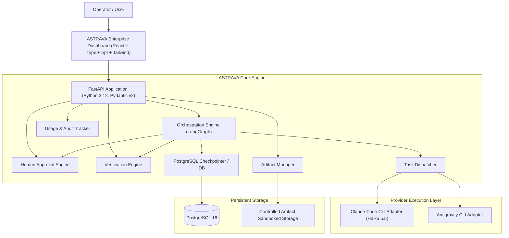
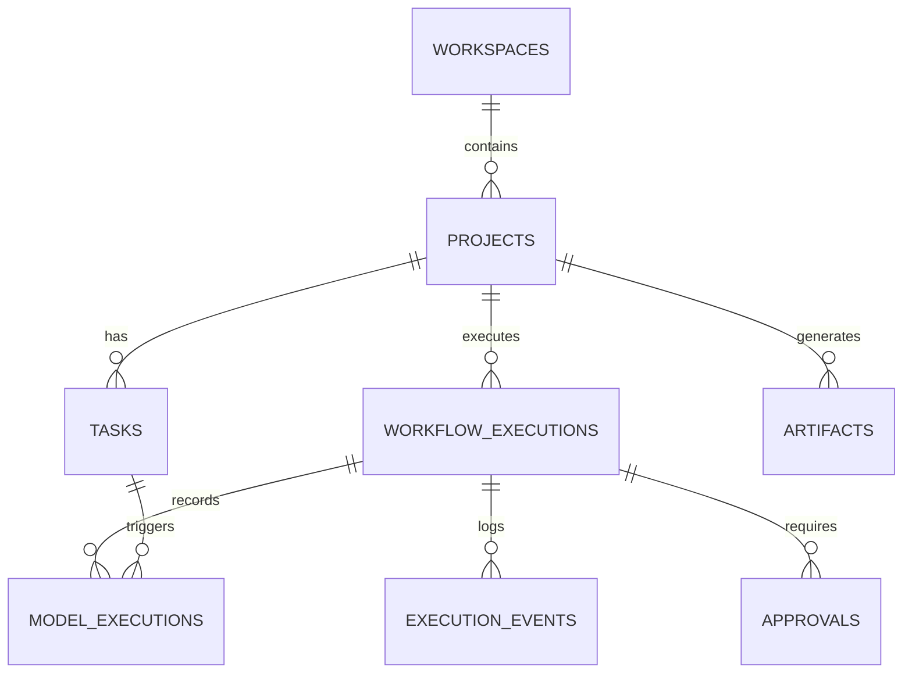

# ASTRAVA System Architecture
**Version:** 1.0.0
**Brand Personality:** Enterprise ("From vision to execution.")

---

## 1. System Overview

ASTRAVA is an enterprise AI creation and orchestration platform designed to turn high-level vision and objectives into functioning software and media assets.

The platform is architected as a **Modular Monolith**:
- Clean separation of concerns between backend domain services, orchestration engine, CLI provider adapters, and frontend client.
- Avoids premature distributed complexity while maintaining high testability, auditability, and execution safety.

---

## 2. Component Architecture

### 2.1 Backend Core (FastAPI & Pydantic v2)
- **Framework:** FastAPI with asynchronous request handlers.
- **Data Validation:** Pydantic v2 schemas for all inputs, outputs, and internal event messages.
- **ORM & Data Layer:** SQLAlchemy 2.0 (asyncio) with Alembic for relational migrations.
- **Security:** Strict sandboxed path resolution, argument array subprocess execution (never raw shell), environment variable filtering, and secret redaction.

### 2.2 Orchestration Engine (LangGraph)
- **Workflows:** Stateful multi-step graphs coordinating:
  1. Plan formulation (validated structured output).
  2. Plan inspection & approval check (interrupt on required approval).
  3. Task dispatching to executor.
  4. Execution output capture and sandboxed working directory monitoring.
  5. Deterministic verification (ruff, pytest, typecheck, build).
  6. Git diff and artifact capture.
  7. State persistence.
- **Checkpointing:** Backed by PostgreSQL to survive backend restarts and support pause/resume.

### 2.3 Provider Execution Layer
- **Claude Code CLI Adapter:**
  - Invokes `claude --model haiku -p --output-format json "<task_prompt>"` within a dedicated project working directory.
  - Subprocess executed with argument arrays (`shell=False`).
  - Strict timeouts, stdout/stderr capture, exit code tracking.
  - Metadata parsing: tokens, cache reads/writes, durations, cost calculations.
- **Future Adapters:** Pluggable `BaseProvider` architecture ready for Antigravity CLI and additional models.

### 2.4 Human Approval Engine
- Workflows pause automatically before high-risk tasks (destructive filesystem changes, deployments, paid operations).
- Emits approval requests with risk level, context, and expected impact.
- Resumes workflow seamlessly once approved or branches to alternative on rejection.

### 2.5 Verification Engine
- AI output is treated as untrusted.
- Executes deterministic validation tools:
  - Python: `ruff check`, `ruff format --check`, `pytest`.
  - Frontend: `npm run lint`, `tsc --noEmit`, `npm run build`.
  - System: Git diff inspection, health checks.

### 2.6 Artifact Management
- Metadata stored in PostgreSQL (`artifacts` table).
- Content stored in sandboxed local filesystem directory (`storage/artifacts/<project_id>/...`).
- Path traversal protection ensuring all paths remain strictly inside the project's designated artifact storage.

---

## 3. Database Schema Concept

---

## 4. Frontend Visual Architecture
- **Enterprise Design System:**
  - Primary colors: Midnight Navy (`#101827`), Slate Blue (`#253B59`), Electric Blue (`#3B82F6`), Ice Blue (`#B9D8FF`).
  - Neutrals: Cloud White (`#F8FAFC`), Steel Gray (`#64748B`).
  - Semantics: Success (`#16A34A`), Warning (`#D97706`), Danger (`#DC2626`), Info (`#2563EB`).
  - Typography: Inter for UI body/headings, JetBrains Mono for code/logs.
- **Navigation:**
  - Overview
  - Command Center
  - Projects
  - Executions
  - Artifacts
  - Approvals
  - Intelligence
  - Settings
