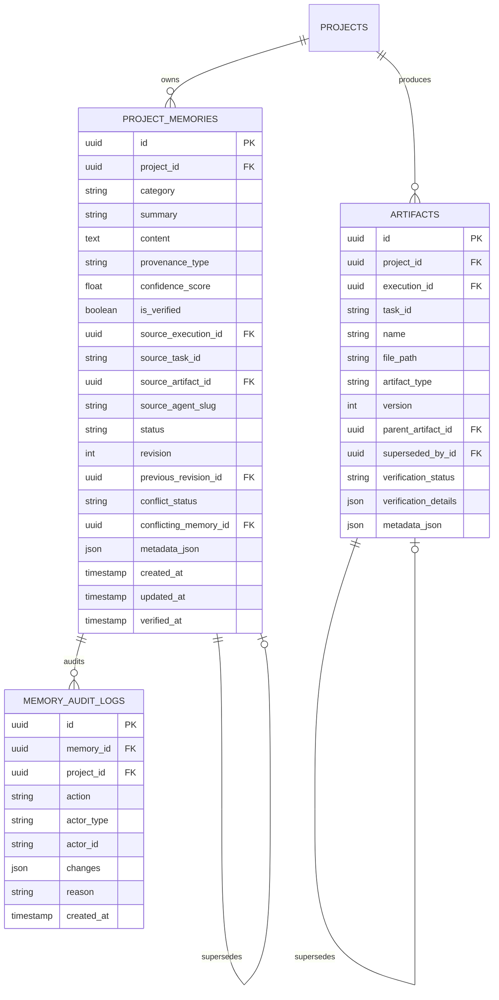

# ASTRAVA V1.3 — PERSISTENT PROJECT INTELLIGENCE: ARCHITECTURE ASSESSMENT

**Author:** Lead AI Architect & Technical Lead  
**Date:** 2026-11-01  
**Baseline Commit:** `f3aa9b95ec01d8882c57f04a4a7abf34180fb8d5`  
**Target Milestone:** ASTRAVA V1.3 — Persistent Project Intelligence  
**AI Executor:** Canonical Claude Haiku 5.5 (`claude-haiku-5-5`) via non-interactive Claude Code CLI  

---

## 1. EXECUTIVE SUMMARY & OBJECTIVE

The primary objective of **ASTRAVA V1.3** is to transform ASTRAVA from an execution-isolated orchestration engine into a platform with **Persistent Project Intelligence**.

In V1.2.1, ASTRAVA executes dynamic multi-agent DAGs reliably, survives OS-level process crashes, handles transient failures with bounded retries, and enforces deterministic verification. However, each execution pipeline currently operates with a blank slate regarding long-term project context:
- Architectural decisions made in Execution A are not automatically remembered in subsequent Execution B.
- Discarded approaches and known constraints have to be re-discovered or re-prompted by the user.
- Artifacts lack formal lineage graphs (versioning, supersession, parent-child dependencies).
- Context injected into prompts is limited to immediate upstream prerequisites within the single DAG.

ASTRAVA V1.3 introduces **project-scoped persistent memories**, **artifact intelligence graphs**, **modular knowledge retrieval**, **LangGraph memory lifecycle hooks**, and **interactive memory governance UI**, enabling agents to build cumulatively on prior knowledge without prompt bloating or hallucination risks.

---

## 2. REPOSITORY & ARCHITECTURAL BASELINE AUDIT

### 2.1 Codebase Inspection
- **Git Tree:** Clean, synchronized with `origin/main` at commit `f3aa9b9`. Local Git identity verified as `Abstract <61998277+DonyNurArifR@users.noreply.github.com>`.
- **Backend Stack:** Python 3.12, FastAPI, SQLAlchemy 2.0 Async, PostgreSQL 16 (port 5433), Pydantic v2, LangGraph 0.2+, Alembic.
- **Frontend Stack:** React 19, TypeScript, Tailwind CSS v4, Vite 8, Lucide React, Oxlint, Vitest.
- **Provider Layer:** Non-interactive Claude Code CLI (`2.1.316`), canonical model `claude-haiku-5-5`, zero paid external API keys.
- **Current Tests:** 33/33 backend Pytest passing; 8/8 frontend Vitest suites passing; 0 Oxlint warnings.

### 2.2 Existing Intelligence & Artifact Assets
1. `backend/app/services/intelligence_service.py`: Currently provides objective classification, complexity estimation, and agent recommendations. It does *not* manage long-term project memory.
2. `backend/app/api/v1/intelligence.py` & `backend/app/schemas/intelligence.py`: Currently expose model execution metrics and telemetry.
3. `backend/app/models/artifact.py`: Stores flat artifact metadata (`project_id`, `execution_id`, `task_id`, `name`, `file_path`, `artifact_type`, `file_size_bytes`). Lacks lineage, parent references, versioning, and supersession links.
4. `backend/app/orchestrator/runner.py` & `workflow_graph.py`: Manages per-wave execution, checkpoint commits, and context slicing across immediate task dependencies.

---

## 3. CORE ARCHITECTURAL GAPS IDENTIFIED FOR V1.3

| Domain | Current State (V1.2.1) | Required State (V1.3) | Architectural Gap |
|---|---|---|---|
| **Memory Storage** | No memory entity; state is ephemeral per execution checkpoint. | Persistent project-scoped memories across 10 categories with provenance and revision history. | New `ProjectMemory` and `MemoryAuditLog` models, migrations, and CRUD service. |
| **Provenance & Trust** | No distinction between user facts, verified code discoveries, and agent assumptions. | Explicit 4-tier provenance model (`user_provided`, `verified_finding`, `agent_conclusion`, `assumption`) with confidence scores. | Schema validation and non-silent promotion gates. |
| **Governance & Conflicts** | Inflight updates can overwrite or drift silently. | Conflict detection engine, immutable revision history, and Human-in-the-Loop approval for consequential changes. | `conflict_status` tracking, approval workflows for conflicting decisions. |
| **Artifact Intelligence** | Flat file registration; no relationship between artifacts. | Artifact lineage DAG: parent-child links, integer versioning, supersession pointers, and memory associations. | Schema migrations to `artifacts` table; lineage traversal API. |
| **Knowledge Retrieval** | Blind upstream task text truncation (3500 chars). | Semantic & lexical retrieval service with recency weighting, category filtering, and strict token/char budgets (max 4000 chars). | PostgreSQL Full-Text Search (`tsvector`/`tsquery`) + recency ranking engine. |
| **LangGraph Integration** | Workflow starts from raw objective string. | Pre-execution memory retrieval (`project_context_package`) and post-execution memory ingestion from verified tasks. | New LangGraph lifecycle nodes (`retrieve_memory`, `ingest_memory`). |
| **Frontend UI** | `IntelligencePage` only shows usage tokens/cost cards. | Full Project Intelligence Hub: Memory explorer, category filters, provenance badges, conflict resolution modal, artifact lineage graph. | Comprehensive frontend UI extension following enterprise design system. |

---

## 4. DESIGN OF CORE V1.3 SUBSYSTEMS

### 4.1 Data Model: Project Memories & Lineage



#### Memory Categories
1. `objective`: Core project vision and strategic aims.
2. `requirement`: Functional, non-functional, and compliance requirements.
3. `constraint`: Architectural, technical, time, or cost boundaries.
4. `decision`: Formal architectural decisions (e.g. choice of database, auth protocol).
5. `discovery`: Validated technical discoveries (e.g. API limitations, performance findings).
6. `preference`: Code conventions, UI tone, design preferences.
7. `open_question`: Unresolved spikes or items requiring clarification.
8. `risk`: Identified risks, failure modes, and mitigation strategies.
9. `milestone`: Key achievements and verified release gates.
10. `rejected_approach`: Discarded architectures or libraries with explicit rationale.

#### Provenance Hierarchy
- `user_provided` (Confidence: 1.0, Verified: True) — Direct user input or explicit instructions.
- `verified_finding` (Confidence: 0.95, Verified: True) — Empirically proven outputs passing automated tests.
- `agent_conclusion` (Confidence: 0.70, Verified: False) — Hypothesized conclusions proposed by agents.
- `assumption` (Confidence: 0.50, Verified: False) — Unverified assumptions requiring validation.

> [!IMPORTANT]
> Unverified agent conclusions or assumptions are NEVER silently promoted into verified facts or active constraints without human approval or passing verification suites.

### 4.2 Retrieval Engine & PostgreSQL Full-Text Search Strategy
Rather than prematurely introducing an external vector database container (which adds operational overhead, memory consumption, and sync complexity), ASTRAVA V1.3 leverages native PostgreSQL 16 capabilities:
1. **Full-Text Search (`tsvector` & `tsquery`):** GIN-indexed English dictionary lexemes matching queries across `summary` (weight A) and `content` (weight B).
2. **Relevance Scoring:** `ts_rank_cd(to_tsvector('english', summary || ' ' || content), query) * confidence_score * recency_factor`.
3. **Strict Context Budgeting:** Maximum 4,000 characters (~1,000 tokens) formatted with clear Markdown headers, source attribution, and truncation safeguards.
4. **Pluggable Interface:** Implemented behind an abstract `BaseKnowledgeRetrievalEngine` interface so future vector indexing (e.g. `pgvector`) can be added without altering orchestration logic.

### 4.3 Conflict Detection & Governance
When an agent or user proposes a new memory in categories `decision` or `constraint`:
- The service performs similarity matching against existing active memories in the same category.
- If a semantic contradiction or conflicting directive is identified:
  - Both memories are retained.
  - The new memory is flagged with `conflict_status="detected"` and links to `conflicting_memory_id`.
  - It does NOT silently overwrite or displace the active decision.
  - An operator can resolve the conflict via the API/UI by selecting:
    - `supersede`: Marks old memory as `status="superseded"` and activates new memory.
    - `reject`: Rejects the proposed memory with a reason.
    - `merge`: Creates a unified resolution memory with both source links.
  - If triggered during an active pipeline, routes to `ApprovalService` if the conflict exceeds risk thresholds.

### 4.4 LangGraph Pipeline Integration Flow

```mermaid
flowchart TD
    Start([Pipeline Launch]) --> RetrieveMem[Node: retrieve_project_knowledge]
    RetrieveMem --> Plan[Node: plan]
    Plan --> ApprCheck{Node: approval_check}
    ApprCheck -->|Approval Needed| WaitAppr[State: waiting_approval]
    WaitAppr -->|Resume / Operator Approval| ApprCheck
    ApprCheck -->|Wave Ready| Dispatch[Node: dispatch_task (Parallel Wave)]
    Dispatch --> Verify[Node: verify (Deterministic QA)]
    Verify --> Artifact[Node: artifact]
    Artifact --> ApprCheck
    ApprCheck -->|All Tasks Finished| IngestMem[Node: ingest_project_memories]
    IngestMem --> Complete[Node: complete]
    Complete --> End([Pipeline Finished])
```

1. **`retrieve_project_knowledge` Node:** Runs before planning, fetches top relevant active memories for the project, and injects a bounded `project_context_package` into `state["project_context_package"]`.
2. **`dispatch_task` Node:** Injects both upstream prerequisite outputs and project memories into the task prompt.
3. **`ingest_project_memories` Node:** Runs before `complete`, inspects completed tasks that passed verification, extracts structured memory proposals, validates schemas, verifies lineage, checks for conflicts, and commits memories to PostgreSQL.

---

## 5. SECURITY & RELIABILITY CONTROLS
1. **Project Scoping:** All memory queries and mutations enforce `WHERE project_id = :project_id`. No cross-project context leakage.
2. **Secret Redaction:** Memory summaries and content pass through `SecretRedactor` to strip credentials, API keys, and sensitive tokens.
3. **Prompt Injection Defense:** Retrieved memories are wrapped in demarcated context containers: `<project_knowledge provenance="..." id="...">` with strict character limits.
4. **Optimistic Concurrency & ACID Integrity:** Memory updates verify `revision = expected_revision` to prevent lost updates under simultaneous requests.
5. **Crash Durability:** Memory ingestions occur within explicit database transactions with per-stage commits.

---

## 6. PROPOSED MILESTONE ROADMAP (V1.3)

| Milestone | Title | Scope | Deliverables |
|---|---|---|---|
| **M1.3-1** | Architecture Assessment & Planning | Codebase audit, assessment document, milestone plan. | `docs/V1_3_ARCHITECTURE_ASSESSMENT.md`, updated `docs/PROGRESS.md` & `docs/ROADMAP.md`. |
| **M1.3-2** | Database Models & Alembic Migration | `ProjectMemory`, `MemoryAuditLog`, enhanced `Artifact` fields (lineage, version, supersession). | New models, Alembic migration script, migration execution. |
| **M1.3-3** | Core Memory & Artifact Services | `MemoryService`, `ArtifactIntelligenceService`, CRUD, provenance validation, audit logging, conflict detection. | Backend domain services + unit/integration tests. |
| **M1.3-4** | Knowledge Retrieval Engine | Full-Text search, recency scoring, category filters, context budget formatter (max 4000 chars). | `KnowledgeRetrievalEngine` + test suites for relevance and bounds. |
| **M1.3-5** | LangGraph Workflow Integration | `retrieve_project_knowledge` and `ingest_project_memories` nodes, prompt enrichment, memory telemetry. | Updated `workflow_graph.py`, `runner.py`, `state.py`. |
| **M1.3-6** | REST APIs & Schemas | Endpoints for memory CRUD, search, conflict resolution, artifact lineage tree, audit history. | `backend/app/api/v1/memories.py`, `artifacts.py` lineage endpoints. |
| **M1.3-7** | Frontend Project Intelligence Experience | Integrated UI tabs in `IntelligencePage.tsx`: Memory Bank, Provenance badges, Conflict Resolver, Artifact Lineage graph. | React components, API client methods, Oxlint + Vitest tests. |
| **M1.3-8** | Multi-Execution Real Integration & Live Proof | Integration tests, crash recovery during memory ingestion, and 2-phase real execution demonstration proving knowledge reuse across separate runs. | `test_memory_intelligence.py`, live proof verification script, `docs/V1_3_RELEASE_REPORT.md`. |

---

## 7. RECOMMENDATION

Proceed with Milestone **M1.3-2** upon presentation of this plan to begin database model implementations, Alembic migration, and domain service development.
