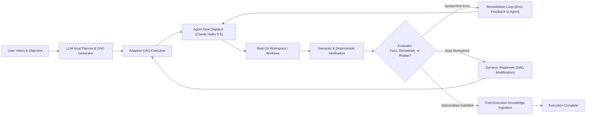

# ASTRAVA V1.4 — Next-Generation Autonomous Intelligence: Architecture Assessment

**Author:** Lead Architect, Principal Technical Strategist & Development Coordinator  
**Date:** 2026-11-03  
**Status:** PLANNING ONLY — BASELINE FROZEN  
**Baseline Commit:** `08355ab5b18c92aa62c06dd7160f784ace964f93` (V1.3 Acceptance & Delivery)  
**Target Milestone Series:** ASTRAVA V1.4  
**Primary Execution Engine:** Canonical Claude Haiku 5.5 (`claude-haiku-5-5`) via Claude Code CLI  

---

## 1. Executive Summary & Objective

ASTRAVA V1.3 established **Persistent Project Intelligence**, equipping the platform with durable project-scoped memories, 4-tier provenance tracking, PostgreSQL 16 full-text search retrieval ($\le 4,000$ character context budgets), immutable audit histories, conflict governance, artifact lineage DAGs, and a responsive Memory Bank UI.

However, an audit of the actual codebase reveals a fundamental architectural constraint:
**ASTRAVA currently executes static, hardcoded plan templates.**
- While the DAG is partitioned into parallel execution stages using Kahn's algorithm, the actual tasks generated for SaaS and Media studios are hardcoded Python lists (`task-1-market-research`, `task-2-competitor-analysis`, ..., `task-8-qa`).
- The system cannot adapt the plan based on intermediate task outputs, unexpected discoveries, or partial failures.
- Verification is shallow: it checks whether `py_compile` succeeds on `.py` files and runs `pytest` if test files exist; if an agent produces markdown PRDs or architecture specs, verification trivially passes without evaluating whether the acceptance criteria were actually satisfied.
- When verification or agent execution fails, the system executes blind retries with identical prompts instead of feeding the failure diagnostics back to the agent in an automated remediation loop.
- The platform does not inspect real local Git repositories; deliverables are written to an isolated local folder (`storage/artifacts/<project_id>`).

The objective of **ASTRAVA V1.4 ("Next-Generation Autonomous Intelligence")** is to transform ASTRAVA from a **static scripted workflow executor** into an **adaptive, goal-driven autonomous creation platform**. V1.4 will endow ASTRAVA with:
1. Dynamic, LLM-driven goal planning and runtime DAG adaptation (replanning based on intermediate findings).
2. Closed-loop semantic evaluation and automated remediation (feeding syntax/lint/test/spec errors back to agents for self-correction).
3. Trusted identity and transactional ingestion safety (resolving V1.3 follow-up risks R1 and R2).
4. First-class execution budgets and stopping conditions (cost, tokens, and turn limits preventing runaway autonomous loops).
5. Repository-aware development workflows (analyzing real codebases, creating branch worktrees, generating clean git diffs).

---

## 2. Comprehensive Review of Existing V1.3 Architecture

### 2.1 Codebase & Baseline Inventory

| Subsystem | Source Location | V1.3 Implementation Reality | Architectural Assessment |
|---|---|---|---|
| **FastAPI Backend** | `backend/app/main.py`, `backend/app/api/v1/` | 10 modular API routers under `/api/v1/` (`agents`, `approvals`, `artifacts`, `executions`, `health`, `intelligence`, `memories`, `orchestrator`, `projects`, `tasks`, `workflows`). Pydantic v2 schemas throughout. | **Strong**: Clean modular monolith structure, predictable error handling, strict input boundaries, comprehensive test coverage (88/88 passing). |
| **Workflow Engine** | `backend/app/orchestrator/workflow_graph.py` | Compiled LangGraph `StateGraph(OrchestrationState)`. Linear-with-stage loop: `retrieve_knowledge` $\rightarrow$ `plan` $\rightarrow$ `approval_check` $\rightarrow$ `dispatch_task` $\rightarrow$ `verify` $\rightarrow$ `artifact` $\rightarrow$ `ingest_knowledge` $\rightarrow$ `complete`. | **Mixed**: State transitions are clear and checkpointed, but the graph topology is rigid. No branch for evaluation failure, replanning, or dynamic subtask insertion. |
| **Dynamic DAG Planner** | `backend/app/orchestrator/planner.py` | `PlannerService.generate_plan` returns hardcoded Python lists of 8 tasks for `SAAS` and 8 tasks for `MEDIA`. Kahn's algorithm validates DAG and computes stages. | **Major Limitation**: "Dynamic" is a misnomer; only the topological sort is dynamic. The task decomposition is completely static and blind to actual repo state or nuanced user goals. |
| **Agent Registry & Adapter** | `backend/app/models/agent.py`, `backend/app/providers/claude_code.py` | 16 seeded agent personas. Invocations format prompts and call `claude --model haiku -p --output-format json` with subprocess argument arrays, secret redaction, and 120s timeout. | **Solid Foundation**: Subprocess safety and cost/token tracking are excellent. However, agents cannot invoke tools dynamically or collaborate across task boundaries; `available_tools` in the DB is cosmetic metadata. |
| **Verification Engine** | `backend/app/verification/engine.py` | Runs `py_compile` on up to 10 `.py` files, `pytest` on up to 5 test files, and `json.loads` on `.json` files. | **Shallow**: Completely ignores non-Python deliverables. No semantic evaluation of acceptance criteria. Zero feedback provided to agents when a check fails. |
| **Project Memory & Retrieval** | `backend/app/models/memory.py`, `backend/app/services/retrieval/` | PostgreSQL 16 Full-Text Search with GIN index on `to_tsvector('english', summary || ' ' || content)`. Multi-signal ranking, strict 4,000 char budget context assembler. | **High Quality**: Fast (p50 = 34.00 ms), zero external vector DB dependencies, rock-solid character budget enforcement. |
| **Memory Governance** | `backend/app/services/memory_service.py`, `memory_audit_service.py` | Conflict detection (`DETECTED`), 3 resolution strategies (`supersede`, `reject`, `merge`), optimistic concurrency (`expected_revision`), audit survival on hard deletion. | **Enterprise Ready**: Full revision history and immutable audit trails. |
| **Artifact Intelligence** | `backend/app/services/artifact_intelligence_service.py` | Parent-child lineage, integer versioning, supersession chains, cycle detection, project scoping. | **Strong**: Clean graph traversal without recursive loops. |
| **Frontend UI** | `frontend/src/pages/IntelligencePage.tsx`, `CommandCenterPage.tsx` | React 19, Tailwind CSS v4, Lucide icons, Vitest (16/16 tests passing). Memory Bank, Conflict Workbench, Artifact Lineage tree, Model Telemetry. | **Polished**: Enterprise aesthetic, fast render, clear auditability. |

---

## 3. Analysis of V1.3 Follow-up Risks (R1 & R2)

### 3.1 R1 — Verification Identity and Authorization Analysis

#### Current State in Codebase
In `backend/app/api/v1/memories.py`:
```python
@router.post("/{memory_id}/verify", response_model=MemoryRead)
async def verify_memory(
    project_id: uuid.UUID,
    memory_id: uuid.UUID,
    data: MemoryVerifyRequest,
    db: AsyncSession = Depends(get_db),
) -> MemoryRead:
    ...
    verified = await MemoryService.verify_memory(
        db=db,
        project_id=project_id,
        memory_id=memory_id,
        verified_by=data.verified_by,  # <--- Directly supplied by client JSON body!
        verification_details=data.verification_details,
        actor_type="user",  # <--- Hardcoded string!
        actor_id="user",  # <--- Hardcoded string!
        reason=data.reason or f"Verified by {data.verified_by}",
    )
```

#### Vulnerability & Findings
1. **Unauthenticated Endpoints:** The application contains zero authentication middleware, session tokens, or API keys. Any HTTP client capable of reaching port 8000 can execute verification calls.
2. **Identity Impersonation:** The `verified_by` field is arbitrary client-supplied text. A malicious caller or errant script can submit `verified_by: "Lead-Architect"` or `verified_by: "Security-Council"` without proof of identity.
3. **Audit Trail Contamination:** The `memory_audit_logs` table records `actor_id="user"` for all API requests and stores the spoofed `verified_by` string in its snapshot, providing a false sense of cryptographic or administrative authority.

#### Minimal & Appropriate Solution for Single-User ASTRAVA
ASTRAVA is currently a single-user / local-team developer platform. Introducing full enterprise OAuth2/OIDC, multi-tenant RBAC, and permissions tables would introduce massive accidental complexity.
**Proposed Remediation for V1.4:**
1. **Application-Level Operator Key / Session Secret:** Introduce an optional `OPERATOR_API_KEY` or signed local session cookie in `backend/app/config.py`.
2. **Trusted Request Context Dependency:** Implement a FastAPI dependency (`get_current_actor`) that extracts actor credentials:
   - In local development mode without security configured, it defaults to the configured system operator (`settings.DEFAULT_OPERATOR_IDENTITY`, e.g., `"Abstract"` or local git user).
   - In protected mode, it validates `X-ASTRAVA-KEY` or Bearer token, deriving `actor_id` and `verified_by` directly from the authenticated identity, rejecting unauthenticated or spoofed claims.
3. **Service Layer Assertion:** `MemoryService.verify_memory` requires `actor_id` to match `verified_by` unless the actor possesses explicit `system` role.

---

### 3.2 R2 — Concurrent Ingestion Idempotency Analysis

#### Current State in Codebase
In `backend/app/orchestrator/workflow_graph.py` (`ingest_knowledge_node`):
```python
# 1. Non-atomic check
existing_stmt = select(ProjectMemory).where(
    ProjectMemory.project_id == project_uuid,
    ProjectMemory.source_execution_id == execution_uuid,
)
existing = list((await session.execute(existing_stmt)).scalars().all())
for m in existing:
    sig = (str(m.category), str(m.summary), str(m.source_task_id or ""))
    existing_by_sig[sig] = m

for cand in candidates:
    cand_sig = (str(cand.category), str(cand.summary), str(cand.source_task_id or ""))
    if cand_sig in existing_by_sig:
        continue
    # 2. Sequential insertion without DB constraint
    mem = await MemoryService.create_memory(...)
```
And in `backend/app/models/memory.py`:
- There are check constraints (`ck_project_memories_confidence_range`, etc.) and indexes (`ix_project_memories_tsv`).
- There is **no unique index or database-level constraint** on `(project_id, source_execution_id, source_task_id, summary)` or candidate signature!

#### Vulnerability & Findings
1. **Time-of-Check to Time-of-Use (TOCTOU) Race:** If two workers or concurrent processes ingest memories for the same project or execution simultaneously, both perform the `select`, find no existing rows, and proceed to `insert`. Both transactions commit, creating duplicate memory rows and duplicate audit logs.
2. **Corrupted Session Rollback:** Line 620 executes `await session.rollback()` if an individual candidate fails. This rolls back the entire session up to that point, yet the loop continues attempting subsequent candidates, resulting in an inconsistent transaction state.
3. **Execution vs. Memory Concept Confusion:** Currently, idempotency relies on `source_execution_id`. If an execution retries a task wave and generates an updated finding under the same task, the system either duplicates it or fails to associate it properly.

#### Durable Remediation for V1.4
1. **Deterministic Candidate Fingerprint (`fingerprint` column):** Add a deterministic hash column to `project_memories`:
   $$\text{fingerprint} = \text{SHA256}(\text{project\_id} \,\|\, \text{category} \,\|\, \text{summary} \,\|\, \text{source\_execution\_id} \,\|\, \text{source\_task\_id})$$
2. **Database Unique Constraint:** Add a partial or unique index on `(project_id, fingerprint)` for active/proposed memories.
3. **PostgreSQL Advisory Lock / `ON CONFLICT DO NOTHING`:**
   - Wrap the ingestion node execution in a PostgreSQL transactional advisory lock: `pg_advisory_xact_lock(hashtext(execution_id::text))`.
   - Use atomic `INSERT ... ON CONFLICT (project_id, fingerprint) DO NOTHING` semantics in `MemoryService`.
4. **Nested Transactions (Savepoints):** Use `async with session.begin_nested():` per candidate so that an individual failure rolls back only that candidate without aborting the parent batch.

---

## 4. Evaluation of V1.4 Capability Areas

| Capability Area | Description | Architectural Value | Complexity | Risk | Priority & Recommendation |
|---|---|---|---|---|---|
| **A. Advanced Agent Intelligence** | Dynamic capability matching, tool registry, agent performance evaluation. | Medium-High | High | Medium | **Selective for V1.4**: Introduce capability matching and a formal tool registry. Defer autonomous agent-to-agent delegation to V1.5. |
| **B. Advanced Workflow Orchestration** | Adaptive planning, dynamic DAG modification, failure-driven replanning, execution budgets. | **CRITICAL** | High | Medium | **CORE V1.4 PRIORITY**: This is the defining transformation. Replacing static templates with LLM goal planning and runtime replanning delivers massive product differentiation. |
| **C. Persistent Project Intelligence** | Knowledge decay, cross-artifact reasoning, evaluation of retrieval precision. | Medium | Medium | Low | **Incremental for V1.4**: Enhance retrieval ranking with decay; preserve core V1.3 memory engine without major rewrites. |
| **D. Autonomous Development Capabilities** | Repository structure understanding, local git branch integration, automated remediation loops. | **CRITICAL** | High | High | **CORE V1.4 PRIORITY**: Grounding agent execution in real repositories and feeding test/syntax errors back to agents in remediation loops makes ASTRAVA truly useful for engineering. |
| **E. Autonomous Media Capabilities** | Script-to-storyboard pipelines, asset generation, rendering orchestration. | Medium | High | High | **DEFER TO V1.5**: External media rendering and generative visual APIs introduce external dependencies, high costs, and architectural divergence. |
| **F. Operational Intelligence** | Cost/token budget limits, stopping conditions, execution analytics, bottleneck detection. | **HIGH** | Medium | Low | **CORE V1.4 PRIORITY**: First-class budgets and stopping conditions are essential safety rails to prevent runaway autonomous loops and unexpected resource usage. |

---

## 5. The Single Most Important V1.4 Architectural Evolution

### "From Scripted Workflows to Adaptive, Goal-Driven Orchestration with Closed-Loop Remediation"

ASTRAVA V1.0 through V1.3 proved that a Python FastAPI + LangGraph + PostgreSQL modular monolith can reliably coordinate agents, survive hard process crashes, persist knowledge, and present clean UI governance.

However, ASTRAVA is currently **blind and rigid**:
1. It plans by selecting from hardcoded templates regardless of what the user actually wants or what code already exists in their project.
2. It executes tasks sequentially or in static parallel waves without observing whether intermediate outputs succeeded or failed.
3. When code or artifacts have syntax errors or fail automated tests, it executes a blind retry with the exact same prompt, hoping for a different result, before giving up.
4. It operates on an isolated mock directory instead of the developer's real repository.

**The defining architectural mission of V1.4 is to close the loop:**


### Why this matters:
1. **Genuine Autonomy:** The platform actually reads the codebase, writes targeted code, runs the test suite, catches its own errors, feeds the stack trace back to the agent, fixes the code, and verifies that the tests pass.
2. **Defensible Value:** Any script can execute a static list of prompts. A system that adaptively replans, bounds its own token budget, and self-corrects until verification passes provides enterprise-grade value.
3. **Safety & Predictability:** Governed by hard execution budgets, loop detection, and human approval gates, preventing runaway LLM loops.
