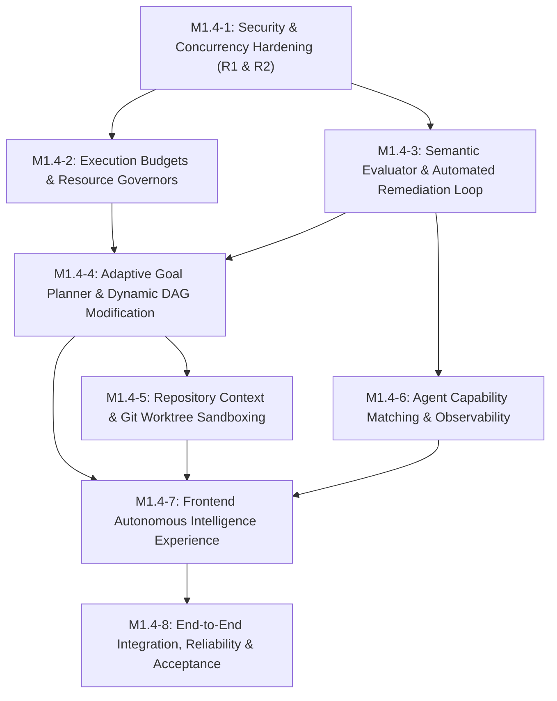

# ASTRAVA V1.4 — Next-Generation Autonomous Intelligence: Development Roadmap

**Author:** Lead Architect, Principal Technical Strategist & Development Coordinator  
**Date:** 2026-11-03  
**Status:** PLANNING ONLY — MILESTONE DEFINITIONS  
**Baseline Release:** V1.3 Frozen Baseline (`08355ab5b18c92aa62c06dd7160f784ace964f93`)  
**Product Version:** ASTRAVA V1.4  

---

## 1. Milestone Summary & Dependency Graph

| Milestone ID | Milestone Name | Primary Focus | Dependencies |
|---|---|---|---|
| **M1.4-1** | Security & Concurrency Hardening | Resolve V1.3 R1 (trusted verifier identity) and R2 (concurrent ingestion idempotency). | Baseline V1.3 |
| **M1.4-2** | Execution Budgets & Resource Governors | Hard token, cost, wall-time, and turn limits with proactive halting. | M1.4-1 |
| **M1.4-3** | Semantic Evaluator & Automated Remediation | Closed-loop error feedback into agent prompts; self-correction on verification failure. | M1.4-1 |
| **M1.4-4** | Adaptive Goal Planner & Dynamic DAG Modification | Dynamic LLM goal decomposition and runtime replanning based on intermediate findings. | M1.4-2, M1.4-3 |
| **M1.4-5** | Repository Context & Git Worktree Sandboxing | Isolated git worktrees for real codebases; structural repository scanner for planning. | M1.4-4 |
| **M1.4-6** | Agent Capability Matching & Observability | Formal tool registry, capability-based task dispatch, and granular latency/token telemetry. | M1.4-3 |
| **M1.4-7** | Frontend Autonomous Intelligence Experience | Command Center v2: Adaptive DAG viewer, Remediation inspector, Budget progress bar. | M1.4-4, M1.4-5, M1.4-6 |
| **M1.4-8** | End-to-End Integration, Reliability & Acceptance | Multi-scenario autonomous acceptance proof, real SIGKILL recovery, baseline freeze. | M1.4-7 |

---

## 2. Detailed Milestone Specifications

### M1.4-1: Security & Concurrency Hardening (R1 & R2)
- **Business Objective:** Eliminate verifier identity impersonation and guarantee database-level concurrency safety for project memory ingestion.
- **Technical Scope:**
  - Create `app.core.auth` module with single-user `OperatorContext` dependency (`get_current_actor`).
  - Secure `POST /api/v1/projects/{project_id}/memories/{memory_id}/verify` to enforce authenticated verifier attribution, rejecting spoofed identities with HTTP 403.
  - Add computed SHA-256 `fingerprint` column and unique partial index on `project_memories(project_id, fingerprint)`.
  - Implement PostgreSQL transactional advisory lock (`pg_advisory_xact_lock`) and nested transaction savepoints (`session.begin_nested()`) in `ingest_knowledge_node`.
- **Dependencies:** Baseline V1.3.
- **Database Changes:** Alembic migration adding `fingerprint VARCHAR(64)` and unique partial index `uq_project_memories_active_fingerprint`.
- **API Changes:** Update `verify_memory` endpoint to derive verifier from `get_current_actor`.
- **Frontend Changes:** None (transparent security hardening).
- **Acceptance Criteria:**
  - Attempting to verify a memory with a spoofed name different from the authenticated actor fails or records the authentic actor.
  - 10 concurrent async ingestion tasks attempting to ingest identical candidates result in exactly 1 set of memories and 0 database duplicates.
  - A failure in one candidate does not roll back prior valid candidates in the batch.
- **Test Strategy:** New test suite `tests/test_v1_4_security_and_concurrency.py`.
- **Definition of Done:** 100% backend tests passing; Alembic migration applied and verified; zero ruff warnings.

---

### M1.4-2: Execution Budgets, Resource Limits & Stopping Conditions
- **Business Objective:** Prevent runaway autonomous loops, unexpected token costs, or hung processes by enforcing first-class resource limits.
- **Technical Scope:**
  - Create `app.orchestrator.budget` module with `BudgetGovernor` class.
  - Define `ExecutionBudget` schema: `max_cost_usd` (default $1.00), `max_input_tokens` (250k), `max_output_tokens` (50k), `max_remediation_cycles` (5), `max_replan_count` (2), `max_wall_time_seconds` (600s).
  - Inject budget checks into `OrchestrationRunner` and LangGraph dispatch/replan edges.
  - On budget exhaustion: gracefully pause execution (`ExecutionStatus.PAUSED`), record stopping reason, and emit event `pipeline_budget_paused`.
  - Add REST endpoint `POST /api/v1/executions/{id}/budget/adjust` to allow operators to expand limits.
- **Dependencies:** M1.4-1.
- **Database Changes:** Alembic migration adding `budget_consumed_json` and `budget_limits_json` to `workflow_executions`.
- **API Changes:** New endpoints `GET /api/v1/executions/{id}/budget` and `POST /api/v1/executions/{id}/budget/adjust`.
- **Frontend Changes:** Budget indicator component showing token/cost consumption vs. hard ceiling.
- **Acceptance Criteria:**
  - Configured pipeline halting precisely when cost or token thresholds are reached.
  - Pipeline resumes cleanly when operator calls budget adjustment endpoint.
- **Test Strategy:** Unit tests in `tests/test_execution_budgets.py`.
- **Definition of Done:** Budget governor unit and integration tests passing; zero regressions.

---

### M1.4-3: Semantic Evaluator & Automated Remediation Loop
- **Business Objective:** Replace blind retries with intelligent self-correction, feeding syntax, test, and spec diagnostics back to agents to automatically resolve errors.
- **Technical Scope:**
  - Enhance `VerificationEngine` (Tier 1) to extract structured error summaries (line numbers, test failures, compiler output bounded to 2,500 chars).
  - Implement `SemanticEvaluator` (Tier 2): evaluates deliverable against task `acceptance_criteria` using Claude Haiku 5.5, generating compliance score and unmet criteria list.
  - Implement `remediation_node` in LangGraph: formats focused diagnostic prompts, increments `remediation_cycle_count`, and routes back to `dispatch_tasks_node`.
  - Enforce max 3 remediation cycles per task; if still failing, routes to evaluation decision.
- **Dependencies:** M1.4-1.
- **Database Changes:** Add `remediation_history_json` to `tasks` and `remediation_count` to `workflow_executions`.
- **API Changes:** `GET /api/v1/executions/{id}/remediations` returning full cycle history and error diffs.
- **Frontend Changes:** Remediation badge and history drawer in execution detail view.
- **Acceptance Criteria:**
  - Agent that generates code with a deliberate syntax error receives the compiler trace, fixes the syntax error on attempt 2, and successfully passes verification.
  - Tasks exceeding 3 remediation cycles halt without infinite looping.
- **Test Strategy:** New test suite `tests/test_automated_remediation.py`.
- **Definition of Done:** Automated self-correction verified; test suite passing.

---

### M1.4-4: Adaptive Goal Planner & Dynamic DAG Modification
- **Business Objective:** Replace hardcoded task templates with dynamic LLM goal decomposition and runtime DAG adaptation based on intermediate findings.
- **Technical Scope:**
  - Implement `GoalDecomposer`: uses Claude Haiku 5.5 to synthesize a structured DAG (`PlannedTask` nodes with dependencies, acceptance criteria, and agent assignments) customized to the objective, retrieved persistent memories, and studio type.
  - Implement `replan_node` in LangGraph: triggered when evaluation detects goal divergence or task failure. Modifies remaining unexecuted tasks, validates DAG acyclicity via Kahn's algorithm, and updates `state["tasks"]`.
  - Enforce replan guardrails: max 2 replans per execution; completed tasks remain immutable.
  - Add `project_goals` table tracking high-level intent, milestones, and convergence state.
- **Dependencies:** M1.4-2, M1.4-3.
- **Database Changes:** Alembic migration creating `project_goals` table; adding `goal_id` and `replan_count` to `workflow_executions`.
- **API Changes:** New endpoints under `/api/v1/projects/{id}/goals` and `POST /api/v1/executions/{id}/replan`.
- **Frontend Changes:** Goal creation modal and progress tracker.
- **Acceptance Criteria:**
  - Goal decomposition produces distinct, non-templated DAGs for different user objectives.
  - Runtime replanning successfully modifies remaining tasks when a prerequisite discovery indicates an architectural change.
- **Test Strategy:** New test suite `tests/test_adaptive_planning.py`.
- **Definition of Done:** Dynamic planning verified across both SaaS and Media studios; Kahn's algorithm cycle prevention verified.

---

### M1.4-5: Repository Context & Git Worktree Sandboxing
- **Business Objective:** Ground autonomous development in real local Git repositories using isolated Git worktrees, generating authentic git diffs.
- **Technical Scope:**
  - Implement `GitWorktreeManager`: creates ephemeral worktrees under `storage/worktrees/<exec_id>` on an isolated branch `astrava/exec-<exec_id>`. Prunes worktrees on completion or failure.
  - Implement `RepoScanner`: scans repository root, extracts directory tree, identifies language/framework toolchains (`pyproject.toml`, `package.json`), and generates a compact context summary ($\le 1,500$ tokens) for the planner.
  - Configure `VerificationEngine` to execute repository-native test runners (e.g. `pytest`, `npm test`) inside the worktree.
  - Add endpoint `GET /api/v1/executions/{id}/diff` and `POST /api/v1/executions/{id}/merge`.
- **Dependencies:** M1.4-4.
- **Database Changes:** Add `repo_path` and `base_branch` to `projects`; add `worktree_path` to `workflow_executions`.
- **API Changes:** Add diff and merge endpoints for executions.
- **Frontend Changes:** Git Diff Viewer tab in Execution Detail modal.
- **Acceptance Criteria:**
  - Worktree creation, task execution, and file edits occur on isolated branch without modifying the main repository working tree.
  - Pruning routine removes worktree cleanly upon execution completion.
- **Test Strategy:** New test suite `tests/test_git_worktrees.py`.
- **Definition of Done:** Worktree sandboxing verified; zero workspace contamination.

---

### M1.4-6: Agent Capability Matching & Observability
- **Business Objective:** Match tasks to agents based on declared capabilities and tools; provide granular observability into latency, token usage, and agent effectiveness.
- **Technical Scope:**
  - Formalize `AgentCapability` schema and bind capabilities to registered agents in PostgreSQL.
  - Implement capability-based dispatch: `GoalDecomposer` specifies required capabilities; dispatcher matches the best-fit agent persona.
  - Track agent performance metrics: task success rate, remediation frequency, cost-efficiency.
  - Expose agent observability endpoints under `/api/v1/agents/metrics`.
- **Dependencies:** M1.4-3.
- **Database Changes:** Add `capabilities` JSONB column to `agents`.
- **API Changes:** `GET /api/v1/agents/{slug}/metrics`.
- **Frontend Changes:** Agent capability badges and performance KPI cards on `AgentsPage`.
- **Acceptance Criteria:**
  - Dispatcher routes database migration tasks to `database-architect` and UI tasks to `frontend-developer` based on capability matching rather than hardcoded strings.
- **Test Strategy:** Unit tests in `tests/test_agent_capabilities.py`.
- **Definition of Done:** Capability dispatch verified; telemetry tracked accurately.

---

### M1.4-7: Frontend Autonomous Intelligence Experience
- **Business Objective:** Deliver a unified user experience for monitoring autonomous goal execution, adaptive DAG replanning, remediation feedback loops, and resource budgets.
- **Technical Scope:**
  - Upgrade `CommandCenterPage.tsx`: Interactive DAG visualizer highlighting parallel waves, replanned tasks, and remediation cycles in real time.
  - Build `GoalsPage.tsx`: Dashboard for managing high-level project goals, completion criteria, and triggering autonomous runs.
  - Build `RemediationInspector`: Modal component showing compiler/test error diagnostics side-by-side with the agent's corrective patch.
  - Build `BudgetProgressIndicator`: Real-time token and cost progress bar with visual alerts at 80% and 100% of budget.
- **Dependencies:** M1.4-4, M1.4-5, M1.4-6.
- **Database Changes:** None.
- **API Changes:** None (consumes APIs delivered in M1.4-1 through M1.4-6).
- **Frontend Changes:** New pages and components in React 19 + Tailwind CSS v4.
- **Acceptance Criteria:**
  - Real-time display of dynamic replanning events and remediation cycles.
  - Vitest test coverage for all new UI components (100% pass rate, 0 Oxlint errors).
- **Test Strategy:** Vitest unit and integration tests in `frontend/src/__tests__/`.
- **Definition of Done:** All frontend tests passing; production build succeeds cleanly.

---

### M1.4-8: End-to-End Integration, Reliability & Acceptance
- **Business Objective:** Prove that ASTRAVA V1.4 operates reliably as an integrated autonomous system across multi-stage goal planning, remediation loops, real repository worktrees, and crash recovery.
- **Technical Scope:**
  - Comprehensive end-to-end integration test exercising:
    - High-level goal creation $\rightarrow$ Dynamic LLM decomposition $\rightarrow$ Worktree dispatch $\rightarrow$ Real error detection $\rightarrow$ Automated remediation loop $\rightarrow$ Successful verification $\rightarrow$ Knowledge ingestion with fingerprint deduplication.
  - Real OS-level `SIGKILL` crash testing during an active remediation cycle, verifying clean recovery from checkpoint upon restart.
  - Performance and budget compliance validation across both SaaS and Media studio pipelines.
  - Author `docs/V1_4_FINAL_ACCEPTANCE_REPORT.md` and freeze V1.4 baseline.
- **Dependencies:** M1.4-7.
- **Database Changes:** None.
- **API Changes:** None.
- **Frontend Changes:** None.
- **Acceptance Criteria:**
  - Full autonomous loop successfully completes an engineering task with automated self-correction.
  - 100% backend and frontend test pass rate.
  - 0 ruff errors, 0 oxlint errors, clean git working tree.
- **Test Strategy:** `tests/test_v1_4_e2e_acceptance.py` and `scratch/test_v1_4_crash_recovery.py`.
- **Definition of Done:** Full acceptance report signed off; git commit and push to `origin/main`.

---

## 3. Recommended First Implementation Milestone

### **Recommended First Milestone: M1.4-1 (Security & Concurrency Hardening)**

#### Architectural Justification:
1. **Resolves Known Baseline Risks:** Directly fixes V1.3 follow-up findings R1 (spoofed verifier identity) and R2 (concurrent ingestion race condition).
2. **Foundational Pre-requisite:** Before introducing dynamic replanning and autonomous loops, the underlying database constraints, unique indexes, and operator identity contracts must be rock-solid.
3. **Low Complexity, High Leverage:** M1.4-1 requires minimal code footprint (one Alembic migration, auth dependency, advisory lock wrapper) while completely securing the data integrity foundation.
4. **Zero Frontend Overhead:** Allows full backend test validation before initiating larger architectural changes.

---

## 4. Recommended Acceptance Strategy

1. **Deterministic Verification Gate:** Every milestone must pass 100% of backend pytest tests and frontend Vitest suites with zero compiler, linter (`ruff`), or build (`vite`) warnings.
2. **Real Infrastructure Only:** All tests run against PostgreSQL 16 (port 5433) in Docker; zero in-memory SQLite mocks.
3. **Empirical Process Kill Verification:** Any milestone touching execution state or worktree management must include a controlled OS-level `SIGKILL` test verifying crash survival.
4. **Budget & Cost Tracking:** All autonomous loops executed via Claude Code CLI must report exact token consumption and cost metrics, proving adherence to canonical Claude Haiku 5.5 and zero paid API billing.
