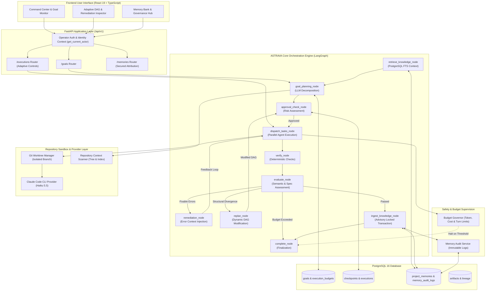

# ASTRAVA V1.4 — Next-Generation Autonomous Intelligence: Target Architecture

**Author:** Lead Architect, Principal Technical Strategist & Development Coordinator  
**Date:** 2026-11-03  
**Status:** PLANNING ONLY — TARGET ARCHITECTURE SPECIFICATION  
**Baseline Release:** V1.3 Frozen Baseline (`08355ab5b18c92aa62c06dd7160f784ace964f93`)  
**Design Paradigm:** Modular Monolith with Adaptive Goal-Driven Orchestration  

---

## 1. Architectural Philosophy & Design Principles

ASTRAVA V1.4 preserves the **Modular Monolith** architecture:
- Single unified backend process (FastAPI + SQLAlchemy 2.0 Async + LangGraph).
- Relational integrity and transactions backed by PostgreSQL 16.
- Sandboxed CLI provider execution (Claude Code CLI with canonical Claude Haiku 5.5).
- Single-page application client (React 19 + TypeScript + Tailwind CSS v4).

**Core Design Principles for V1.4:**
1. **Goal-Driven Autonomy, Not Scripted Sequences:** Replace hardcoded task templates with semantic LLM goal decomposition conditioned on the active project repository and persistent knowledge.
2. **Closed-Loop Verification & Remediation:** Rather than blind retries on failure, the system evaluates deliverables, extracts actionable error diagnostics (syntax traces, pytest failures, missing schema fields), and dispatches focused remediation tasks back to agents.
3. **Deterministic Bounds & Hard Stopping Conditions:** Every autonomous loop is strictly governed by maximum replanning iterations, token/cost budgets, and timeout limits.
4. **Authentic Repository Grounding:** Workflows operate directly on the target project's real Git repository via isolated Git worktrees, preserving commit history and producing genuine git diffs.
5. **Zero-Trust Identity & Concurrency Safety:** Verifier identity is cryptographically or session-derived, and knowledge ingestion is guarded by database-level constraints and transactional locks.

---

## 2. Target System Architecture Diagram



---

## 3. Core Subsystems Breakdown

### 3.1 Adaptive Goal & Dynamic Replanning Engine (`app.orchestrator.planner`)

#### Problem in V1.3:
Hardcoded static lists of 8 tasks for SaaS and 8 tasks for Media. No capability to adapt, insert new tasks, or drop unnecessary steps.

#### Target V1.4 Architecture:
1. **`GoalDecomposer`:** Uses Claude Haiku 5.5 with structured JSON output schema to decompose the high-level user objective into a dynamic `StructuredPlan`. Inputs include:
   - User objective and studio type.
   - Bounded project intelligence context (active architectural decisions, constraints, previous milestones from `RetrievalService`).
   - Repository structural summary (file tree, tech stack, detected dependencies from `RepoScanner`).
2. **`DAGModifier`:** Handles runtime graph alterations. If intermediate execution indicates a change of scope or unexpected blocker, the `replan_node` evaluates the remaining unexecuted tasks, updates dependencies, validates the revised DAG using Kahn's algorithm, and commits the updated plan to `WorkflowExecution.state_data`.
3. **Replan Guardrails:**
   - Maximum replanning iterations per execution: default **2** (configurable, max 5).
   - Tasks already completed are marked immutable and never deleted.
   - Any replan that introduces high-risk operations (e.g. schema migration, deletion of existing modules) triggers a required human approval interrupt.

---

### 3.2 Evaluation & Closed-Loop Remediation (`app.verification`)

#### Problem in V1.3:
Verification runs basic checks; on failure, tasks are retried blindly with the identical initial prompt. Non-Python deliverables trivially pass with zero evaluation.

#### Target V1.4 Architecture:
1. **Two-Tier Verification & Evaluation:**
   - **Tier 1: Deterministic Engine (`VerificationEngine`):** Executes fast automated linters, syntax checks, pytest suites, and git diff inspection against the worktree.
   - **Tier 2: Semantic Evaluator (`SemanticEvaluator`):** Compares deliverable content against the task's declared `acceptance_criteria` and `output_schema`. Assigns a compliance score and extracts structured issue list.
2. **`RemediationCoordinator`:**
   - If Tier 1 or Tier 2 checks fail, instead of aborting the pipeline or blindly re-running the original prompt, the coordinator constructs a **Remediation Task**:
     ```markdown
     Your previous deliverable for task '{task_title}' failed verification:
     
     ## Verification Failures:
     {format_test_failures_or_syntax_errors(report)}
     
     ## Specific Acceptance Criteria Not Met:
     {unmet_criteria}
     
     Inspect the error diagnostics above and modify the files to fix all issues.
     ```
   - Max remediation attempts per task: **3**.
   - If errors persist after 3 attempts, the task is marked `failed` and routed to the `evaluate_node` to determine whether to replan around it or request human intervention.

---

### 3.3 Trusted Verification Identity & Single-User Security (`app.core.auth`)

#### Problem in V1.3 (R1):
`verified_by` in `POST /memories/{id}/verify` is an unauthenticated client string that can be freely spoofed.

#### Target V1.4 Architecture:
1. **Operator Identity Configuration:** In `app.config.Settings`:
   - `OPERATOR_NAME`: Defaults to system environment (e.g. local git user or `"Abstract"`).
   - `OPERATOR_API_KEY`: Optional shared secret for authenticated REST access.
2. **`get_current_actor` FastAPI Dependency:**
   - Extracts authorization header: `Authorization: Bearer <key>` or `X-ASTRAVA-OPERATOR: <name>`.
   - In local developer mode (no key required), derives actor from verified local config.
   - In secured mode, validates token against hashed secret.
   - Generates an immutable `ActorContext(actor_id, actor_type, display_name, is_authorized_verifier)`.
3. **Service Layer Assertion:**
   - `MemoryService.verify_memory` accepts `actor: ActorContext`.
   - Derives `verified_by = actor.display_name` automatically; client cannot override it with a forged string.

---

### 3.4 Concurrently-Safe Database Ingestion Engine (`app.orchestrator.workflow_graph`)

#### Problem in V1.3 (R2):
Race condition during concurrent ingestion; no unique constraint on `project_memories`; individual candidate errors rollback the entire session.

#### Target V1.4 Architecture:
1. **Candidate Fingerprint:** Add a computed SHA-256 fingerprint column to `project_memories`:
   $$\text{fingerprint} = \text{sha256}(\text{project\_id} + \text{category} + \text{summary} + \text{source\_task\_id})$$
2. **Database Unique Partial Index:**
   ```sql
   CREATE UNIQUE INDEX uq_project_memories_active_fingerprint
   ON project_memories (project_id, fingerprint)
   WHERE status IN ('active', 'proposed');
   ```
3. **Transactional Advisory Lock:**
   - Prior to querying or inserting memories during ingestion, the worker acquires a transaction-scoped PostgreSQL advisory lock:
     ```sql
     SELECT pg_advisory_xact_lock(hashtext('ingest_' || :execution_id));
     ```
   - Concurrent ingestion requests for the same execution serialize cleanly.
4. **Nested Transactions (Savepoints):**
   - Each memory candidate is persisted within a sub-transaction: `async with session.begin_nested():`.
   - If candidate $A$ violates a constraint, its savepoint rolls back without invalidating candidate $B$ or committing partial state.

---

### 3.5 Repository Context & Workspace Sandboxing (`app.workspace`)

#### Problem in V1.3:
Tasks execute inside `storage/artifacts/<project_id>`, completely disconnected from real code repositories.

#### Target V1.4 Architecture:
1. **Project Repository Binding:** Add `repo_path` and `base_branch` to the `Project` model.
2. **Git Worktree Isolation (`GitWorktreeManager`):**
   - For every workflow execution, create an ephemeral Git worktree:
     ```bash
     git worktree add -b astrava/exec-<id> storage/worktrees/<exec_id> <base_branch>
     ```
   - Agents modify real files inside the isolated worktree without corrupting the developer's working directory.
   - On completion, ASTRAVA generates a clean git diff, registers code artifacts, and offers to merge or export a pull request.
   - On cancellation or failure, the worktree is cleanly pruned: `git worktree remove --force`.
3. **Repository Context Scanner (`RepoScanner`):**
   - Generates a compact structural summary ($\le 1,500$ tokens) of the repository: directory tree, detected frameworks (`pyproject.toml`, `package.json`, `Cargo.toml`), entry points, and test paths.
   - Injected into the `GoalDecomposer` so plans target real existing files.

---

### 3.6 Execution Budgets & Stopping Conditions (`app.orchestrator.budget`)

#### Problem in V1.3:
Costs and tokens are logged passively; runaway loops or runaway LLM queries can burn compute unbounded.

#### Target V1.4 Architecture:
1. **Execution Budget Model (`ExecutionBudget`):**
   - Attached to `WorkflowExecution`.
   - Configurable parameters:
     - `max_cost_usd`: Default **$1.00** (hard cap).
     - `max_input_tokens`: Default **250,000**.
     - `max_output_tokens`: Default **50,000**.
     - `max_remediation_cycles`: Default **5** total across execution.
     - `max_replan_count`: Default **2**.
     - `max_wall_time_seconds`: Default **600s** (10 minutes).
2. **`BudgetGovernor` Enforcement:**
   - Evaluated before every agent task dispatch and before every replanning iteration.
   - If cost or tokens exceed 80% of budget: logs high-priority warning.
   - If any hard limit is hit: sets `execution.status = ExecutionStatus.PAUSED`, records stopping reason (`"budget_exhausted"`), and interrupts the LangGraph pipeline, requesting human operator budget expansion to continue.

---

## 4. Module Inventory & Delta Specification

| Module | Status | Role in V1.4 | Architectural Changes |
|---|---|---|---|
| `app.models.project` | Extended | Project Entity | Add `repo_path`, `base_branch`, `default_budget_config`. |
| `app.models.execution` | Extended | Workflow Execution | Add `budget_consumed_json`, `replan_count`, `remediation_count`, `worktree_path`. |
| `app.models.goal` | **NEW** | Autonomous Goals | New `ProjectGoal` model tracking high-level intent, milestones, and convergence state. |
| `app.models.memory` | Extended | Project Memory | Add `fingerprint` column and unique partial index. |
| `app.core.auth` | **NEW** | Operator Identity | Dependency `get_current_actor` for non-spoofable attribution. |
| `app.workspace.worktree` | **NEW** | Git Worktrees | Ephemeral worktree lifecycle management and branch creation. |
| `app.workspace.scanner` | **NEW** | Repo Scanner | Fast structural code context extractor for planning. |
| `app.orchestrator.planner` | Rewritten | Adaptive Planning | Replace hardcoded task lists with LLM `GoalDecomposer` and `DAGModifier`. |
| `app.verification.engine` | Extended | Tier 1 Checks | Support real repository test runners (pytest, npm test, cargo test). |
| `app.verification.evaluator` | **NEW** | Tier 2 Evaluation | Semantic acceptance criteria scoring and structured remediation generator. |
| `app.orchestrator.budget` | **NEW** | Resource Safety | `BudgetGovernor` tracking tokens, costs, turns, and hard limits. |
| `app.orchestrator.workflow_graph`| Extended | LangGraph Graph | Add `evaluate`, `remediate`, and `replan` nodes and conditional routing. |
| `frontend/src/pages/CommandCenter`| Extended | UI Dashboard | Real-time adaptive DAG visualizer, remediation count chips, budget progress bar. |
| `frontend/src/pages/GoalsPage` | **NEW** | Goal Management | View project goals, completion progress, and active autonomous pipelines. |
| `frontend/src/components/` | Extended | UI Components | `RemediationModal`, `BudgetLimitIndicator`, `WorktreeDiffViewer`. |

---

## 5. Proposed Database Schema Changes (Alembic Migration V1.4)

### New Table: `project_goals`
```sql
CREATE TABLE project_goals (
    id UUID PRIMARY KEY DEFAULT gen_random_uuid(),
    project_id UUID NOT NULL REFERENCES projects(id) ON DELETE CASCADE,
    title VARCHAR(255) NOT NULL,
    description TEXT NOT NULL,
    status VARCHAR(50) NOT NULL DEFAULT 'active', -- active, achieved, paused, cancelled
    target_criteria JSONB NOT NULL DEFAULT '[]'::jsonb,
    progress_percentage FLOAT NOT NULL DEFAULT 0.0,
    created_at TIMESTAMPTZ NOT NULL DEFAULT NOW(),
    updated_at TIMESTAMPTZ NOT NULL DEFAULT NOW()
);
CREATE INDEX ix_project_goals_project_status ON project_goals (project_id, status);
```

### Table Extension: `project_memories`
```sql
ALTER TABLE project_memories ADD COLUMN fingerprint VARCHAR(64) NULL;
CREATE UNIQUE INDEX uq_project_memories_active_fingerprint
ON project_memories (project_id, fingerprint)
WHERE status IN ('active', 'proposed');
```

### Table Extension: `projects`
```sql
ALTER TABLE projects ADD COLUMN repo_path VARCHAR(500) NULL;
ALTER TABLE projects ADD COLUMN base_branch VARCHAR(100) NOT NULL DEFAULT 'main';
ALTER TABLE projects ADD COLUMN budget_defaults_json JSONB NOT NULL DEFAULT '{"max_cost_usd": 1.0, "max_remediation_cycles": 5}'::jsonb;
```

### Table Extension: `workflow_executions`
```sql
ALTER TABLE workflow_executions ADD COLUMN goal_id UUID NULL REFERENCES project_goals(id) ON DELETE SET NULL;
ALTER TABLE workflow_executions ADD COLUMN replan_count INT NOT NULL DEFAULT 0;
ALTER TABLE workflow_executions ADD COLUMN remediation_count INT NOT NULL DEFAULT 0;
ALTER TABLE workflow_executions ADD COLUMN budget_consumed_json JSONB NOT NULL DEFAULT '{}'::jsonb;
ALTER TABLE workflow_executions ADD COLUMN worktree_path VARCHAR(500) NULL;
```

---

## 6. Target API Delta

| Method | Endpoint | Description |
|---|---|---|
| `POST` | `/api/v1/projects/{id}/goals` | Create a high-level autonomous goal. |
| `GET` | `/api/v1/projects/{id}/goals` | List project goals with convergence progress. |
| `POST` | `/api/v1/projects/{id}/goals/{goal_id}/execute` | Launch adaptive execution pipeline for a goal. |
| `POST` | `/api/v1/executions/{id}/replan` | Force an explicit replan of remaining unexecuted tasks. |
| `GET` | `/api/v1/executions/{id}/budget` | Current token consumption, cost accrued, and budget limit. |
| `POST` | `/api/v1/executions/{id}/budget/adjust` | Expand budget limit for a paused execution. |
| `GET` | `/api/v1/executions/{id}/remediations` | List remediation cycles with diagnostic feedback and resolution diffs. |
| `GET` | `/api/v1/executions/{id}/diff` | Full Git diff produced in the execution worktree against base branch. |
| `POST` | `/api/v1/executions/{id}/merge` | Merge verified execution branch back into target project repository. |
